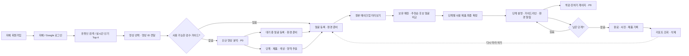

# 기능명세서

<callout icon="📌" color="blue_bg">
<b>기능명세서</b> — 기능 단위 구현 기준 문서. 깃 저장소 공유용.

- 기능별 원본: <mention url="https://app.notion.com/p/720dce3252f68290a65081cefe0606a0" /> DB의 각 기능 페이지
- 기능 내용 변경 시 DB 페이지와 본 문서 함께 갱신
</callout>

## 문서 읽는 법

- 기능 1개 = <code>도메인-번호</code> ID 1개 = 사용자·시스템의 독립 결과 1개
- 기능 ID는 Jira 이슈·커밋 scope·API 명세에 그대로 사용 (Git·Jira Convention 참조)
- 기능별 구성
  - 헤더: <code>기능 ID 명칭</code>
  - 메타: 대상 · 우선순위 · 링크(Features DB)
  - 기능 설명: 정상 흐름 (반드시 구현할 동작)
  - 주요 정책·예외: 제약·분기·오류 처리
- 표기 규칙
  - <code>(비기능)</code>: 수치·기준은 비기능명세서에서 확정. 구현 시 설정값으로 분리, 하드코딩 금지
  - <code>(확인 필요 N)</code>: 미확정 사항. 임의 결정 금지, 기본 동작만 구현 후 <code>TODO(확인 필요 N)</code> 표시
  - 다른 기능 ID 참조: 해당 기능의 정책 그대로 적용
- 결번(GUIDE-005·009·012 등): 삭제·통합된 기능. 신규 기능에 재사용 금지

## 우선순위 기준

- <b>P0</b>: MVP 필수. 현재 전 기능 P0
- <b>P1</b>: 일정 여유 시. 없어도 시연 가능
- <b>P2</b>: 후속 확장. MVP 구현·시연 범위 미포함
- <b>제외</b>: 이번 범위 미구현. 하단 '제외 기능' 참조
- 신규 영상 분석 요청·상태 확인(VIDEO-002·003), 색감·진하기 게이지(GUIDE-013)도 P0

## 용어

- <b>가이드</b>: 영상을 단계별로 따라 하는 흐름 전체 (단계 안내·이동·사진 저장·완료)
- <b>가이드라인</b>: 얼굴 위에 겹쳐 그리는 영역·윤곽선·시작점·방향 화살표
- <b>원본 가이드 데이터</b>: 영상에서 추출한 단계·부위·제품·도구·방법·목표 발색·도포 영역·영상 구간
- <b>매칭 결과</b>: 단계별로 내 화장품을 원본 제품과 대조한 결과. 아래 3종 중 하나
  - 동일: 같은 제품·호수 보유
  - 대체 가능: 같은 용도 + 색이 비슷한 보유 제품 (최대 3개)
  - 없음: 대체할 보유 제품 없음
- <b>실행</b>: 가이드를 1회 따라 하는 단위. 원본 가이드 + 단계별 매칭 결과 + 최종 선택 제품 + 임시 사진 묶음
- <b>얼굴 등록 이미지</b>: 실행 준비 단계에서 촬영 조건 충족 시 등록하는 정면 얼굴 1장. 해당 실행의 조명·색온도 기준으로만 사용
- <b>제외 단계</b>: 스킨케어·인사·마무리 등 가이드 대상이 아닌 단계. 전체 단계 수 미포함

## 공통 규칙

- 기능 분할 단위: 사용자 또는 시스템이 수행하는 독립 결과. 버튼·API·모델 내부 처리 단위로는 미분할
- 대상 구분
  - 비회원: 로그인 전 (가입·로그인·비밀번호 재설정)
  - 회원: 로그인한 회원
  - 사용자: 로그인한 회원이 직접 수행하는 개인 기능 (= 회원)
  - 시스템: 서버·모델이 자동 수행
- 인증: 모든 업무 기능은 로그인한 회원만 이용. 게스트 둘러보기 미제공
- 데이터 소유: 본인 데이터만 조회·수정·삭제 (USERS-003)
- 단계 수: 영상별 유효 단계 수 사용. 프로토타입의 7단계 고정 제한 미적용
- 화면 전환: 미리보기·제품 선택·튜토리얼은 얼굴 화면 유지 + 하단 UI만 전환 (연속 화면)

## 사용자 흐름

- 실행 시작마다 준비 단계에서 실시간 촬영 조건 확인 → 얼굴 이미지(정면 1장) 등록 → 해당 실행의 환경 기준(조명·색온도)으로만 사용
- 신규 영상 분석·색감·진하기 게이지: P0
- 완료한 실행만 리포트·기록으로 저장
- 완료 기록의 가이드로 새 실행 시작 가능 (다시 따라 하기)

## 기능 목록

| 기능 ID | 명칭 | 대상 | 우선순위 | 요약 | 링크 |
| --- | --- | --- | --- | --- | --- |
| <code>USERS-001</code> | 회원가입 | 비회원 | P0 | 자체 계정 회원가입 | <mention url="https://app.notion.com/p/406dce3252f681449242de686fda8e08" /> |
| <code>USERS-002</code> | 로그인 / 로그아웃 | 회원 | P0 | 자체 로그인·로그아웃 | <mention url="https://app.notion.com/p/406dce3252f681b68679c5c7bab710c3" /> |
| <code>USERS-003</code> | 로그인 상태 | 시스템 | P0 | 로그인 상태 유지·만료 처리 | <mention url="https://app.notion.com/p/406dce3252f68121b248e91d7ab20823" /> |
| <code>USERS-004</code> | Google 로그인 | 비회원/회원 | P0 | Google 계정으로 회원 이용 | <mention url="https://app.notion.com/p/406dce3252f6817ca0c0db4d31610176" /> |
| <code>USERS-005</code> | 비밀번호 재설정 | 비회원 | P0 | 이메일 인증 코드로 비밀번호 재설정 | <mention url="https://app.notion.com/p/406dce3252f6817abab5db470eb6ee7e" /> |
| <code>VIDEO-001</code> | 영상 입력 | 사용자 | P0 | 앱 안 유튜브 검색·선택 | <mention url="https://app.notion.com/p/406dce3252f6818d9138d34e15d1a9ab" /> |
| <code>VIDEO-002</code> | 분석 요청 | 사용자 | P0 | 영상 분석 요청 | <mention url="https://app.notion.com/p/406dce3252f68107b189d388491683a2" /> |
| <code>VIDEO-003</code> | 분석 진행 및 상태 노출 | 사용자 | P0 | 분석 진행·결과 확인 | <mention url="https://app.notion.com/p/406dce3252f681cea9deee54bcbd93a8" /> |
| <code>VIDEO-004</code> | 이용 준비 | 사용자 | P0 | 가이드·얼굴 인식·환경 준비 | <mention url="https://app.notion.com/p/406dce3252f681dfb307f17666dfd7af" /> |
| <code>VIDEO-005</code> | 실시간 인기 영상 Top 4 | 사용자 | P0 | 실시간 인기 영상 조회·선택 | <mention url="https://app.notion.com/p/406dce3252f681058933d7493d617026" /> |
| <code>ANALYSIS-001</code> | 단계 추출 | 시스템 | P0 | 메이크업 단계·영상 구간 추출 | <mention url="https://app.notion.com/p/406dce3252f6813288fce794fce9ea35" /> |
| <code>ANALYSIS-002</code> | 제품 추출 | 시스템 | P0 | 레퍼런스 제품·도구 추출 | <mention url="https://app.notion.com/p/406dce3252f68184bda9ece6b3cf109b" /> |
| <code>ANALYSIS-003</code> | 제품 대조 | 시스템 | P0 | 레퍼런스 제품 DB 대조 | <mention url="https://app.notion.com/p/406dce3252f681a8a2d3e6c3f9dbde65" /> |
| <code>ANALYSIS-004</code> | 발색 추출 | 시스템 | P0 | 단계별 목표 발색 추출 | <mention url="https://app.notion.com/p/406dce3252f681e49c50ce3706fdd132" /> |
| <code>ANALYSIS-005</code> | 도포 정보 | 시스템 | P0 | 도포 영역·방향 구성 | <mention url="https://app.notion.com/p/406dce3252f681c58d27d5ee74dab9f3" /> |
| <code>ANALYSIS-006</code> | 가이드 구성 | 시스템 | P0 | 단계별 가이드 데이터 구성 | <mention url="https://app.notion.com/p/406dce3252f68166b59ec07385787d43" /> |
| <code>POUCH-001</code> | 등록 안내 | 사용자 | P0 | 선택적 내 화장품 등록 안내 | <mention url="https://app.notion.com/p/406dce3252f68124b88ccabcdfb0aed5" /> |
| <code>POUCH-002</code> | 제품 찾기 | 사용자 | P0 | 화장품 DB 검색·상세 선택 | <mention url="https://app.notion.com/p/406dce3252f681f3a527efde2405a30c" /> |
| <code>POUCH-003</code> | 제품 등록 | 사용자 | P0 | DB 선택 또는 직접 입력 등록 | <mention url="https://app.notion.com/p/406dce3252f6815bbdcfeb7dfc7def24" /> |
| <code>POUCH-004</code> | 보유 목록 | 사용자 | P0 | 내 화장품 목록·상세 조회 | <mention url="https://app.notion.com/p/406dce3252f6818ca108c83db8efeebe" /> |
| <code>POUCH-005</code> | 제품 수정 | 사용자 | P0 | 보유 화장품 정보 수정 | <mention url="https://app.notion.com/p/406dce3252f6816cb74febd876fe151a" /> |
| <code>POUCH-006</code> | 제품 삭제 | 사용자 | P0 | 보유 화장품 삭제 | <mention url="https://app.notion.com/p/406dce3252f6815c9959c1b4973f4617" /> |
| <code>RECOMMEND-001</code> | 동일 판정 | 시스템 | P0 | 원본과 같은 보유 제품 찾기 | <mention url="https://app.notion.com/p/406dce3252f681ed84cdc9df2511ca3d" /> |
| <code>RECOMMEND-002</code> | 대체 후보 | 시스템 | P0 | 추천순 대체 후보 선정 | <mention url="https://app.notion.com/p/406dce3252f681c7a8c2f5d91d435dfe" /> |
| <code>CAMERA-001</code> | 거울 화면 | 사용자 | P0 | 카메라 연결·거울 화면 | <mention url="https://app.notion.com/p/406dce3252f68161842ed51c19cac7ce" /> |
| <code>CAMERA-002</code> | 얼굴 인식 | 시스템 | P0 | 얼굴 위치·랜드마크 추적 | <mention url="https://app.notion.com/p/406dce3252f68193b838ecb19e27c10a" /> |
| <code>CAMERA-003</code> | 좌표 매핑 | 시스템 | P0 | 얼굴 부위·화면 좌표 매핑 | <mention url="https://app.notion.com/p/406dce3252f6817ea2adf17f379ac1f8" /> |
| <code>CAMERA-004</code> | 인식·환경 상태 | 사용자 | P0 | 진행 중 인식·환경 확인 및 알림 | <mention url="https://app.notion.com/p/406dce3252f681bb9c7cd6ac1a474074" /> |
| <code>CAMERA-005</code> | 얼굴 등록 | 사용자 | P0 | 실시간 조건 체크·얼굴 이미지 등록 | <mention url="https://app.notion.com/p/406dce3252f6819c987fde4e83c87762" /> |
| <code>PREVIEW-001</code> | 완성 모습 | 사용자 | P0 | 원본 목표 메이크업 미리보기 | <mention url="https://app.notion.com/p/406dce3252f68101aa00c2cd37a8f224" /> |
| <code>GUIDE-001</code> | 시작 준비 | 사용자 | P0 | 시작 전 사용 제품 확인·최종 확정 | <mention url="https://app.notion.com/p/406dce3252f6810087d4efeed850fdcb" /> |
| <code>GUIDE-002</code> | 촬영·저장 동의 | 사용자 | P0 | 얼굴 등록·단계 사진 저장 동의 | <mention url="https://app.notion.com/p/406dce3252f681389206e0476cc29146" /> |
| <code>GUIDE-003</code> | 단계 안내 | 사용자 | P0 | 구체적 방법·확정 제품 안내 | <mention url="https://app.notion.com/p/406dce3252f681728d64d93921429e1a" /> |
| <code>GUIDE-004</code> | 후보 비교 | 사용자 | P0 | 시작 전 대체 후보 얼굴 비교·선택 | <mention url="https://app.notion.com/p/406dce3252f681deb2dad45dc48d66b4" /> |
| <code>GUIDE-006</code> | 도포 안내 | 사용자 | P0 | 얼굴 위 가이드라인 표시 | <mention url="https://app.notion.com/p/406dce3252f68150ab8fe4abcddf1e47" /> |
| <code>GUIDE-007</code> | 단계 이동 | 사용자 | P0 | 이전·다음 단계 이동 | <mention url="https://app.notion.com/p/406dce3252f681d7b178f2a97b20a468" /> |
| <code>GUIDE-008</code> | 단계 촬영 | 사용자 | P0 | 단계별 얼굴 사진 저장 | <mention url="https://app.notion.com/p/406dce3252f6812b85f2eb3973f71ffd" /> |
| <code>GUIDE-010</code> | 완료 | 사용자 | P0 | 완료 결과 확인·기록 저장 | <mention url="https://app.notion.com/p/406dce3252f68193b60ddff438f04b6f" /> |
| <code>GUIDE-011</code> | 종료 | 사용자 | P0 | 가이드 중도 종료 | <mention url="https://app.notion.com/p/406dce3252f681a4979ac7f299b9b0c9" /> |
| <code>GUIDE-013</code> | 색감·진하기 | 시스템/사용자 | P0 | 부위별 색감·진하기 게이지 | <mention url="https://app.notion.com/p/406dce3252f6817687ccf1e5f60baa20" /> |
| <code>REPORT-001</code> | 생성 | 사용자 | P0 | 메이크업 기록 생성 | <mention url="https://app.notion.com/p/406dce3252f6810ab5e4d94ab9958af3" /> |
| <code>REPORT-002</code> | 목록 | 사용자 | P0 | 메이크업 기록 목록 조회 | <mention url="https://app.notion.com/p/406dce3252f681adbe8acdc861a16413" /> |
| <code>REPORT-003</code> | 상세 | 사용자 | P0 | 단계별 사진·사용 제품 조회 | <mention url="https://app.notion.com/p/406dce3252f6810c9324cb77d8103871" /> |
| <code>REPORT-004</code> | 관리 | 사용자 | P0 | 메이크업 기록 삭제 | <mention url="https://app.notion.com/p/406dce3252f681d7b9c2e3b50ff19887" /> |
| <code>REPORT-005</code> | 다시 따라 하기 | 사용자 | P0 | 완료 기록의 가이드로 새 실행 시작 | <mention url="https://app.notion.com/p/406dce3252f6813796cdc2333b30cbd8" /> |

---

## 0. 회원 (USERS)

### USERS-001 회원가입

<b>완료 기준</b>: 필수 입력·약관 검증을 통과하면 계정이 1개 생성되고 로그인 화면으로 이동한다. 이메일 변경 시 중복 확인이 해제되고, 가입 시 중복 이메일은 거절된다.

<b>대상</b> 비회원 · <b>우선순위</b> P0 · <b>링크</b> <mention url="https://app.notion.com/p/406dce3252f681449242de686fda8e08" />

<b>기능 설명</b>

- 이메일·비밀번호 기반 자체 계정 생성
- 입력 항목
  - 필수: 이메일·비밀번호·비밀번호 확인
  - 선택: 생년월일·성별·닉네임·이름·휴대폰 번호
- 약관 동의
  - 필수: 서비스 이용약관 · 개인정보 수집·이용 · 만 14세 이상 확인
  - 선택: 마케팅 정보 수신

<b>주요 정책·예외</b>

- 입력값 검증
  - 이메일: 앞뒤 공백 제거 + 소문자 변환 후 형식·중복 검사. 대소문자만 다른 이메일은 중복 처리
  - 비밀번호: 8\~64자, 영문자·숫자·특수문자 각 1개 이상, 확인값 일치 (상세: API-USERS-001)
  - 닉네임: 앞뒤 공백 제거 후 2\~20자 (한글·영문·숫자·밑줄), 중복 허용
  - 이름: 2\~50자 (한글·영문·공백)
  - 휴대폰 번호: 국내 휴대폰 형식만 허용, 숫자만 저장. 본인 인증 없음. 로그인·계정 찾기에 미사용
  - 생년월일: 과거 날짜만 허용. 입력 시 만 14세 미만 가입 불가
- 약관 동의
  - 필수 약관 3개 중 1개라도 미동의 시 가입 불가
  - 회원별 약관 종류·버전·동의 여부·동의 시각 서버 기록 (마케팅 수신 동의 포함)
- 이메일 중복 확인
  - 이메일 단계의 '중복 확인'으로 가입 가능 여부 사전 확인
  - 확인 전 또는 확인 후 이메일 변경 시 '가입하기' 비활성화
  - 확인 결과는 예약 아님 → 가입 요청 시 중복 재검사 (동시 가입 대비)
- 이메일 소유 확인 (초안, 확인 필요 5 확정 전)
  - 중복 확인 통과 후 이메일로 6자리 인증번호를 발송하고 입력해 확인 (10분 유효·1회용, 재발송 60초 간격·시간당 5회, 틀린 입력 5회 초과 시 재발송 필요)
  - 확인 전 또는 확인 후 이메일 변경 시 '가입하기' 비활성화
  - 적용 여부는 설정으로 제어. 적용하지 않는 환경에서는 인증 없이 가입 (현행 확정 동작)
  - API: API-USERS-012·013 (초안)
- 처리·오류
  - 성공 시 로그인 화면 이동
  - 서버 검증 실패: 해당 입력 칸 아래 안내
  - 가입 처리 중 중복 요청 차단
  - Google 최초 로그인 시 회원 생성·연결은 USERS-004에서 처리

### USERS-002 로그인 / 로그아웃

<b>완료 기준</b>: 올바른 계정으로 로그인하고 로그아웃할 수 있다. 불일치 시 공통 오류를 표시하고 중복 요청과 설정된 반복 실패 제한이 적용된다.

<b>대상</b> 회원 · <b>우선순위</b> P0 · <b>링크</b> <mention url="https://app.notion.com/p/406dce3252f681b68679c5c7bab710c3" />

<b>기능 설명</b>

- 가입 이메일·비밀번호로 로그인
- 로그인 후 본인 화장품·가이드·기록 이용
- 로그아웃

<b>주요 정책·예외</b>

- 이메일 또는 비밀번호 불일치: 원인 구분 없이 공통 오류 안내
- 로그인 성공 시 홈 이동. 파우치 등록은 필수 진입 조건 아님
- 반복 실패 시 일정 시간 시도 제한 + 남은 대기 시간 안내 (횟수·시간: 비기능, 프로토타입 시연값 3회·30초)
- 빈 값이면 로그인 버튼 비활성화
- 처리 중 중복 요청 차단
- 비밀번호 재설정: USERS-005

### USERS-003 로그인 상태

<b>완료 기준</b>: 인증 상태에 따라 진입 화면이 분기되고 타인 데이터 접근이 거절된다. 실행 중 만료되면 재로그인을 안내하고 미완료 리포트를 생성하지 않는다.

<b>대상</b> 시스템 · <b>우선순위</b> P0 · <b>링크</b> <mention url="https://app.notion.com/p/406dce3252f68121b248e91d7ab20823" />

<b>기능 설명</b>

- 로그인 상태 확인
- 회원 기능 접근 제어
- 세션 만료 처리

<b>주요 정책·예외</b>

- 본인 계정 데이터만 조회·수정·삭제 허용
- 앱 진입 시 분기
  - 로그인 유지 → 홈
  - 로그인 정보 없음 → 로그인 화면
  - 세션 만료 → 로그인 화면 + 만료 안내
- 인증 없음·만료 시 재로그인 안내
- 튜토리얼 중 만료 시 '진행 중이던 실행이 기록 없이 종료됨' 함께 안내
- 저장 미완료 요청은 성공으로 미표시
- 재로그인 후 가이드 이어 하기 미제공
- 미완료 실행: 리포트·사용자 기록 미생성 + 임시 데이터 정리 (GUIDE-011)

### USERS-004 Google 로그인

<b>완료 기준</b>: Google 인증 성공·취소·실패를 구분하고 성공 시 회원 세션으로 진입한다. 미확정 계정 연결·최초 가입 정책은 확인 필요 5 확정 후 검증하며 임의 연결하지 않는다.

<b>대상</b> 비회원/회원 · <b>우선순위</b> P0 · <b>링크</b> <mention url="https://app.notion.com/p/406dce3252f6817ca0c0db4d31610176" />

<b>기능 설명</b>

- Google 인증 후 서비스 회원으로 로그인
- 최초 이용 시 서비스 회원 생성 또는 연결

<b>주요 정책·예외</b>

- 인증 취소·실패 시 재시도 안내, 로그인 성공으로 미표시
- 카카오 등 기타 소셜 로그인 미제공
- 자체 계정과 같은 이메일: 자동 연결 안 함. 연결·중복 계정 정책은 (확인 필요 5)
- 최초 로그인 시 약관 동의·추가 정보(이름·휴대폰 번호 등) 수집 방식: (확인 필요 5)
- 로그아웃·세션 만료·데이터 소유권: USERS-002·003 준용

### USERS-005 비밀번호 재설정

<b>완료 기준</b>: 유효한 코드로 비밀번호를 변경할 수 있고 기존 세션이 종료된다. 만료·재발송·재사용 규칙이 적용되며 완료 후 자동 로그인하지 않는다.

<b>대상</b> 비회원 · <b>우선순위</b> P0 · <b>링크</b> <mention url="https://app.notion.com/p/406dce3252f6817abab5db470eb6ee7e" />

<b>기능 설명</b>

- 가입 이메일 입력 → 6자리 인증 코드 발송
- 코드 확인 → 새 비밀번호 저장
- 완료 시 로그인 화면 이동 + 완료 안내

<b>주요 정책·예외</b>

- 코드 발송 응답: 가입 여부와 무관하게 동일 안내 (가입 여부 노출 방지)
- Google로만 가입한 계정: 코드 대신 Google 로그인 안내, 자동 연결 안 함 (USERS-004)
- 인증 코드 규칙
  - 6자리 숫자 · 유효 10분 · 1회용
  - 재발송 간격 60초, 재발송 시 이전 코드 무효
  - 코드 만료 / 시도 횟수 초과 구분 안내
- 새 비밀번호: USERS-001과 동일 규칙
- 변경 성공 시
  - 기존 세션 전체 종료
  - 자동 로그인 안 함
  - 로그인 실패 횟수 초기화
- API: API-USERS-008\~010 (초안)

## 1. 영상 (VIDEO)

### VIDEO-001 영상 입력

<b>완료 기준</b>: YouTube 검색·임베드 확인·영상 선택이 가능하고 검수 가이드 유무에 따라 준비 또는 분석 요청으로 분기한다. 조회 실패·결과 없음·재생 불가가 구분된다.

<b>대상</b> 사용자 · <b>우선순위</b> P0 · <b>링크</b> <mention url="https://app.notion.com/p/406dce3252f6818d9138d34e15d1a9ab" />

<b>기능 설명</b>

- 화면 키보드로 검색어 입력 → YouTube 영상 검색
- 결과 목록 항목: 썸네일·제목·채널·길이·조회수·업로드 시점
- 선택 영상은 임베드 플레이어로 확인
  - 상세에 설명란 챕터(구간) 표시. 챕터는 단계 경계 교차 확인에 사용 (ANALYSIS-001)
- '분석하기' 선택 시 영상 ID 전달
- 사용 가능한 가이드가 있는 영상
  - '가이드 있음' 배지 표시
  - '바로 따라 하기'로 분석 없이 준비(VIDEO-004) 이동

<b>주요 정책·예외</b>

- 검색 주체: 백엔드가 YouTube Data API로 검색 (ADR-002)
- 검색·선택만으로 신규 분석 시작 안 함. 임베드 확인 후 '분석하기'로 요청
  - 예외: Top 4는 탭 = 분석 요청 (VIDEO-005)
- 영상 ID로 기존 결과·진행 작업 확인, 신규 요청은 VIDEO-002
- 재생 불가(임베드 불가) 영상: 목록에 '재생 불가' 표시 + 상세에서 선택 차단
- 검색 실패 / 결과 없음 구분 안내, 실패 시 재시도 제공
- 메타데이터: YouTube API 갱신 정책 준수
- 영상 입력 경로: YouTube 검색·Top 4만 제공
- 검수 완료 가이드만 사용. 신규 결과의 검수 전 공개 여부는 (확인 필요 4)

### VIDEO-002 분석 요청

<b>완료 기준</b>: 기존 결과 재사용·진행 작업 합류·신규 분석 접수가 구분된다. 재사용·합류는 신규 분석 횟수에서 제외되고 한도 초과 시 다음 가능 시점을 안내한다.

<b>대상</b> 사용자 · <b>우선순위</b> P0 · <b>링크</b> <mention url="https://app.notion.com/p/406dce3252f68107b189d388491683a2" />

<b>기능 설명</b>

- 선택 영상 ID로 신규 분석 요청
- 사용 가능한 기존 결과 또는 진행 중 작업 존재 시 재사용

<b>주요 정책·예외</b>

- 영상 ID만으로 분석용 입력 확보로 간주 안 함. 입력 확보 방식·지원 조건 검증 필요 (확인 필요 4)
- 진행 중 작업 존재 시 해당 작업에 합류 + 현재 진행률부터 표시
- 일일 분석 한도
  - 회원별 일일 신규 분석 요청 횟수 제한
  - 기존 가이드 재사용·진행 중 작업 합류는 횟수 미포함
  - 초과 시: '오늘 신규 분석 불가' + 다음 가능 시점 안내, 가이드 있는 영상은 바로 따라 하기 가능 안내
  - 횟수·초기화 시각: (비기능)

### VIDEO-003 분석 진행 및 상태 노출

<b>완료 기준</b>: 현재 분석 단계와 실패·시간 초과·검수 대기·반려를 구분한다. 검수 대기 가이드는 홈에서 상태를 확인할 수 있고 검수 전 이용 가능으로 표시하지 않는다.

<b>대상</b> 사용자 · <b>우선순위</b> P0 · <b>링크</b> <mention url="https://app.notion.com/p/406dce3252f681cea9deee54bcbd93a8" />

<b>기능 설명</b>

- 분석 상태 표시: 대기·진행·완료·실패
- 대기 중 얼굴 등록(CAMERA-005)·환경 준비(VIDEO-004) 제공
- 대기 중 영상에서 찾은 제품 표시 (찾은 제품 수 / 전체)

<b>주요 정책·예외</b>

- 진행 단계 표시: 대기 → 영상 불러오기 → 구간 나누기 → 제품 인식 → 단계 추출 → 가이드 구성
- 실패·시간 초과
  - 멈춘 단계 표시
  - 재시도 가능: '다시 시도'(멈춘 단계부터) + '다른 영상 고르기'
  - 재시도 불가: '다른 영상 고르기'만 제공
- 찾은 제품 표시
  - 보유 여부는 내 파우치 기준으로 표시 (별도 '가진 제품 표시' 저장 없음)
  - 없는 제품만 '탭해서 추가' → 제품 등록(POUCH-003)
  - 등록 후 매칭 재계산(RECOMMEND-001·002)해 표시 갱신
  - 제품 수는 영상별 변수, 고정 'N / 7' 미사용
- 얼굴 준비 완료와 분석 완료 상태 별도 관리
- 검수 상태
  - 분석 완료 ≠ 이용 가능. 검수 대기·반려 구분 안내 (ANALYSIS-006)
  - 검수 대기 가이드: 알림 없이 홈 '검수 중 가이드' 카드로 표시, 홈 진입 시 상태 갱신
  - 검수 완료 → 카드에서 바로 따라 하기 준비 이동
  - 반려 → 카드 제거

### VIDEO-004 이용 준비

<b>완료 기준</b>: 신규·바로·다시 따라 하기 모두 얼굴 등록과 파우치 확인을 거친다. 가이드 준비와 얼굴 준비가 모두 완료된 경우에만 미리보기로 이동한다.

<b>대상</b> 사용자 · <b>우선순위</b> P0 · <b>링크</b> <mention url="https://app.notion.com/p/406dce3252f681dfb307f17666dfd7af" />

<b>기능 설명</b>

- 가이드·얼굴 인식 모델·카메라 준비
- 얼굴 등록 (CAMERA-005)
- 기기 배치·거리·조명·가림 상태 안내
- 신규 분석 대기와 병행. 기존 검수 가이드 이용 시에도 동일 수행

<b>주요 정책·예외</b>

- 준비 상태 2종 분리 표시
  - 가이드 준비: 분석 중 / 검수 대기 / 완료
  - 얼굴 인식 준비: 등록 필요 / 완료
- 둘 다 완료 시 미리보기 이동
- 한쪽만 완료 시 남은 준비·필요 행동 안내 (얼굴 미등록 시 '얼굴 등록하고 미리보기')
- 처리 순서: 실시간 조건 체크 → 얼굴 이미지 촬영·저장 → 얼굴 추적 준비 → 파우치 확인(등록 완료·변경 없음) → 미리보기
- 신규 분석·바로 따라 하기·다시 따라 하기 모두 동일 준비 과정
- 실패 시 재시도
- 별도 준비 화면 필요 여부·대기 상한: 검증 후 결정 (확인 필요 7)

### VIDEO-005 실시간 인기 영상 Top 4

<b>완료 기준</b>: 정해진 운영 기준의 인기 영상 최대 4개를 표시하며 재생 불가 영상은 제외한다. 탭 시 기존 가이드 준비 또는 분석 요청으로 분기하고 조회 실패를 안내한다. 인기 운영 기준은 확인 필요 11 확정 후 검증한다.

<b>대상</b> 사용자 · <b>우선순위</b> P0 · <b>링크</b> <mention url="https://app.notion.com/p/406dce3252f681058933d7493d617026" />

<b>기능 설명</b>

- 메이크업 분야 실시간 인기 영상 상위 4개 노출
- 카드 선택으로 영상 선택

<b>주요 정책·예외</b>

- 고정 선정 목록·사전 분석 완료 목록으로 간주 안 함
- 카드 탭 시 임베드 확인 없이 기존 가이드·분석 작업 확인
  - 가이드 있음 → 바로 따라 하기 준비 (VIDEO-004)
  - 가이드 없음 → 즉시 신규 분석 요청 (VIDEO-002)
- 재생 불가 영상은 Top 4에서 제외
- 조회 실패 시 '인기 영상을 불러오지 못함' 안내
- 인기 기준·집계 범위·갱신 주기: (확인 필요 11)
- 실수 탭으로 분석 한도 소모 가능 → 분석 접수 취소 필요 여부 검토 중 (확인 필요 4)

## 2. 영상 분석·가이드 구성 (ANALYSIS)

### ANALYSIS-001 단계 추출

<b>완료 기준</b>: 유효 단계의 순서·부위·방법·영상 구간이 추출되고 제외 단계는 유효 단계 수에서 빠진다. 유효 단계 0개는 실패 처리된다.

<b>대상</b> 시스템 · <b>우선순위</b> P0 · <b>링크</b> <mention url="https://app.notion.com/p/406dce3252f6813288fce794fce9ea35" />

<b>기능 설명</b>

- 영상에서 메이크업 단계의 순서·부위·방법 추출
- 단계별 해당 영상 구간 추출

<b>주요 정책·예외</b>

- 영상에서 확인 불가한 단계 생성 금지
- 유효 단계 0개 → 분석 실패 처리
- 가이드 대상 아닌 단계(스킨케어·인사·마무리 등) → 제외 단계로 표시
- 30분 초과 영상: 구간 분할 분석, 챕터 있으면 단계 경계 교차 확인

### ANALYSIS-002 제품 추출

<b>완료 기준</b>: 단계별 제품·호수·도구와 출처·확인/추정 여부가 구분된다. 확인하지 못한 제품 정보는 미확인으로 유지된다.

<b>대상</b> 시스템 · <b>우선순위</b> P0 · <b>링크</b> <mention url="https://app.notion.com/p/406dce3252f68184bda9ece6b3cf109b" />

<b>기능 설명</b>

- 단계별 사용 제품·색상명·도구를 확인 가능한 범위에서 추출

<b>주요 정책·예외</b>

- 제품명·호수 미확인 시 '미확인'으로 유지
- 확인 정보 / 추정 정보 구분 저장
- 제품 출처(음성·화면 글자·설명란) 함께 저장
- 설명란에만 있는 제품 → '영상 미확인' 표시
- 추출 제품은 서비스 화장품 DB와 대조 (ANALYSIS-003)

### ANALYSIS-003 제품 대조

<b>완료 기준</b>: DB 대조 결과가 일치·후보·미연결로 구분되고, 보완 후 1회 재대조해도 없으면 미등록 제품으로 표시한다.

<b>대상</b> 시스템 · <b>우선순위</b> P0 · <b>링크</b> <mention url="https://app.notion.com/p/406dce3252f681a8a2d3e6c3f9dbde65" />

<b>기능 설명</b>

- 추출한 제품명·브랜드·호수를 서비스 화장품 DB의 제품·호수와 대조·연결
- DB 미발견 시 설명란·화면 글자 등 다른 출처로 제품명 보완 후 1회 재대조

<b>주요 정책·예외</b>

- 표기 차이 정규화 후 비교: 영문·한글, 띄어쓰기, 약칭
- 연결 결과 3종: 일치 / 후보 / 미연결
- 재대조 후에도 없으면 '미등록 제품' 표시 + 이름만 노출
- 비슷해 보이는 다른 제품 임의 연결 금지
- 사전 선정 영상: 검수 시 DB 추가 또는 직접 연결

### ANALYSIS-004 발색 추출

<b>완료 기준</b>: 추출한 목표 색상을 단계에 연결하고 추정 정보임을 구분한다. 색상 표현·추출 품질 기준은 관련 설계 확정 후 검증한다.

<b>대상</b> 시스템 · <b>우선순위</b> P0 · <b>링크</b> <mention url="https://app.notion.com/p/406dce3252f681e49c50ce3706fdd132" />

<b>기능 설명</b>

- 단계별 목표 색상 정보 추출
- 보유 화장품 매칭(RECOMMEND-002)의 비교 기준으로 사용

<b>주요 정책·예외</b>

- 조명·필터 영향 고려, 추정 정보임을 표시
- 사전 선정 영상: 검수 시 목표 발색 직접 지정 가능

### ANALYSIS-005 도포 정보

<b>완료 기준</b>: 도포 영역·경로·동작이 단계에 연결되고 추출 곤란 시 기본 템플릿 사용 여부가 표시된다.

<b>대상</b> 시스템 · <b>우선순위</b> P0 · <b>링크</b> <mention url="https://app.notion.com/p/406dce3252f681c58d27d5ee74dab9f3" />

<b>기능 설명</b>

- 표준 얼굴 기준으로 단계별 도포 정보 구성
  - 도포 영역
  - 경로: 시작점 → 경유점 → 끝점 순서
  - 동작 방식: 쓸기·왕복·두드리기 등

<b>주요 정책·예외</b>

- 추출 어려운 영역 → 부위별 기본 템플릿 사용 + 템플릿 대체 여부 표시
- 그림자·손 가림의 화장 오인 방지: 해당 부위 범위 안에서만 탐색

### ANALYSIS-006 가이드 구성

<b>완료 기준</b>: 단계·제품·발색·도포 정보·영상 구간이 하나의 가이드로 연결된다. 필수 누락을 검사하고 검수 완료 결과만 공개하며 좌표 버전을 보존한다.

<b>대상</b> 시스템 · <b>우선순위</b> P0 · <b>링크</b> <mention url="https://app.notion.com/p/406dce3252f68166b59ec07385787d43" />

<b>기능 설명</b>

- 추출한 단계·제품·발색·도포 정보 + 영상 구간을 하나의 원본 가이드로 연결

<b>주요 정책·예외</b>

- 필수 정보 누락 검사
- 원본 가이드 / 사용자별 매칭 결과 분리 보관
- 검수 완료 가이드만 사용자 노출
- 얼굴 기준 좌표 버전 함께 저장

## 3. 내 화장품 (POUCH)

### POUCH-001 등록 안내

<b>완료 기준</b>: 최초 안내에서 소개 건너뛰기·파우치 담기·나중에 하기가 동작하고 파우치 등록을 강제하지 않는다. 기기별 안내 완료 여부가 기억된다.

<b>대상</b> 사용자 · <b>우선순위</b> P0 · <b>링크</b> <mention url="https://app.notion.com/p/406dce3252f68124b88ccabcdfb0aed5" />

<b>기능 설명</b>

- 내 화장품 메뉴에서 보유 제품 사전 등록 안내
- 최초 로그인 직후 필수 온보딩으로 강제 안 함

<b>주요 정책·예외</b>

- 검색은 POUCH-002, 등록은 POUCH-003 사용
- 등록 제품 없음 → 매칭에서 '없음' 안내
- 최초 안내: 서비스 소개(3장) + 파우치 담기 안내, 이 기기에서 최초 1회 노출 (브라우저 저장)
  - '건너뛰기': 소개 생략 → 파우치 담기
  - '나중에 할게요': 홈 이동
  - 계정 단위 1회 노출 여부: (확인 필요 9)
- 홈 파우치 비어 있음 → '첫 제품 담기' 안내

### POUCH-002 제품 찾기

<b>완료 기준</b>: 카테고리·종류·브랜드·제품명 입력 후 호수 목록을 선택할 수 있다. 별도 검색 결과 목록은 없고 컬러 조회 실패 시 재시도·직접 입력이 가능하다.

<b>대상</b> 사용자 · <b>우선순위</b> P0 · <b>링크</b> <mention url="https://app.notion.com/p/406dce3252f681f3a527efde2405a30c" />

<b>기능 설명</b>

- 등록 시트에서 카테고리 → 종류 → 브랜드·제품명 입력 → 해당 제품의 호수·컬러 목록 선택
- 별도 카탈로그 검색 결과 목록 화면은 제공하지 않음

<b>주요 정책·예외</b>

- 호수·컬러 목록에 없으면 직접 입력(POUCH-003)으로 연결
- 스킨케어·향수·도구는 호수·컬러 선택을 요구하지 않음
- 같은 제품도 호수 다르면 별도 색상으로 구분
- 컬러 목록 없음 / 조회 실패를 구분하고, 조회 실패 시 재시도 또는 직접 입력 제공

### POUCH-003 제품 등록

<b>완료 기준</b>: 선택 또는 직접 입력 제품이 본인 파우치에 저장된다. 중복은 차단되고 색상 생략 제품은 보관하되 대체 후보에서 제외된다.

<b>대상</b> 사용자 · <b>우선순위</b> P0 · <b>링크</b> <mention url="https://app.notion.com/p/406dce3252f6815bbdcfeb7dfc7def24" />

<b>기능 설명</b>

- DB에서 선택한 제품·호수를 내 화장품에 추가
- DB에 없는 제품: 브랜드·제품명·종류·호수/컬러명 등 직접 입력

<b>주요 정책·예외</b>

- 같은 브랜드·제품명·호수 중복 등록 시 '이미 파우치에 있는 제품이에요' 안내 + 저장 비활성화
- 대표 색상: DB 값 연결. 직접 입력 시 색상은 선택 항목이며 '모르겠어요'로 생략 가능
- 직접 입력 색상의 데이터 확보·검증 방식은 (확인 필요 1)
- 색상 정보 없음 → 보관·동일 판정 가능, 대체 후보에서는 제외
- 제품명·사진·기본 색상값만으로 실제 색상 확정 금지, 출처·추정 여부 구분

### POUCH-004 보유 목록

<b>완료 기준</b>: 9개 카테고리 필터·전체 목록에서 본인 제품을 조회하고, 제품이 없으면 등록 안내를 표시한다.

<b>대상</b> 사용자 · <b>우선순위</b> P0 · <b>링크</b> <mention url="https://app.notion.com/p/406dce3252f6818ca108c83db8efeebe" />

<b>기능 설명</b>

- 파우치 보드·카테고리 필터·전체 목록에서 등록 제품 조회
- 제품·호수·색상 정보 확인
- 카테고리 9개: 베이스·아이·브로우·치크·립·스킨케어·네일·향수·도구
- 종류(하위 분류)
  - 베이스: 쿠션·파운데이션·컨실러·선크림·파우더·스틱
  - 아이: 섀도우 팔레트·마스카라·아이라이너·인조 속눈썹
  - 브로우: 브로우 펜슬
  - 치크: 블러셔·하이라이터·컴팩트
  - 립: 립스틱·립글로스·립틴트·립밤/팟·리퀴드 립
  - 스킨케어: 토너·세럼/앰플·크림·클렌징 폼·클렌징 오일·핸드/아이크림·마스크팩·미스트
  - 네일: 네일 폴리시·네일 파일
  - 향수
  - 도구: 브러시·퍼프·스펀지·뷰러·손거울·족집게·화장솜·면봉

<b>주요 정책·예외</b>

- 등록 제품 없음 → 제품 등록 안내
- 로그인한 회원 본인 화장품만 노출

### POUCH-005 제품 수정

<b>완료 기준</b>: 등록 시트의 항목을 수정할 수 있고 시작 전 매칭에 반영된다. 이미 시작한 실행과 완료 기록의 제품 정보는 변경되지 않는다.

<b>대상</b> 사용자 · <b>우선순위</b> P0 · <b>링크</b> <mention url="https://app.notion.com/p/406dce3252f6816cb74febd876fe151a" />

<b>기능 설명</b>

- 등록 시트와 같은 항목(카테고리·종류·브랜드·제품명·호수·색상) 수정 가능
- DB 연결 제품의 제품·호수 변경과 직접 입력 제품 정보 수정 제공

<b>주요 정책·예외</b>

- 시작 전 매칭에 변경 내용 반영
- 이미 시작한 실행의 확정 제품 정보·완료 기록은 변경 안 함

### POUCH-006 제품 삭제

<b>완료 기준</b>: 삭제 확인 후 본인 파우치에서 제거된다. 시작 전 선택은 재매칭을 요구하고 이미 시작한 실행·완료 기록은 당시 정보를 유지한다.

<b>대상</b> 사용자 · <b>우선순위</b> P0 · <b>링크</b> <mention url="https://app.notion.com/p/406dce3252f6815c9959c1b4973f4617" />

<b>기능 설명</b>

- 내 화장품에서 선택 제품 삭제

<b>주요 정책·예외</b>

- 삭제 전 확인
- 시작 전 선택 제품 삭제 시 재매칭·재선택 안내
- 이미 시작한 실행: 확정 당시 제품 정보 유지, 실행 중 재선택 요구 안 함
- 이후 실행 매칭에서 제외, 완료 기록은 유지

## 4. 보유 화장품 매칭 (RECOMMEND)

### RECOMMEND-001 동일 판정

<b>완료 기준</b>: 매칭 대상 5개 카테고리에서 DB에 연결된 같은 제품·호수만 동일로 판정한다. 다른 호수·원본 호수 미확인은 대체 판정으로 넘긴다.

<b>대상</b> 시스템 · <b>우선순위</b> P0 · <b>링크</b> <mention url="https://app.notion.com/p/406dce3252f681ed84cdc9df2511ca3d" />

<b>기능 설명</b>

- 단계 원본 제품과 같은 제품·호수를 내 화장품에서 탐색

<b>주요 정책·예외</b>

- 매칭 대상은 메이크업 5개 카테고리(베이스·아이·브로우·치크·립)만. 스킨케어·네일·향수·도구는 파우치 보관만 제공하며 동일·대체 매칭에서 제외
- DB와 연결된 원본 제품(ANALYSIS-003)만 판정
- 다음 경우는 동일 아님 → 대체 후보 선정(RECOMMEND-002)으로 이관
  - 같은 제품·다른 호수
  - 원본 호수 미확인

### RECOMMEND-002 대체 후보

<b>완료 기준</b>: 매칭 대상 5개 카테고리의 유효 후보를 추천순 최대 3개 제공하고 추천 수치 없이 순위만 표시한다. 색상 없는 후보와 보관 전용 4개 카테고리는 제외된다. 추천 기준은 확인 필요 2 확정 후 검증한다.

<b>대상</b> 시스템 · <b>우선순위</b> P0 · <b>링크</b> <mention url="https://app.notion.com/p/406dce3252f681c7a8c2f5d91d435dfe" />

<b>기능 설명</b>

- 메이크업 5개 카테고리(베이스·아이·브로우·치크·립)의 동일 제품 없는 단계 대상
- 스킨케어·네일·향수·도구는 대체 후보에서 제외
- 같은 용도·부위 보유 제품을 기준 색과 비교
- AI 추천순 최대 3개 선정

<b>주요 정책·예외</b>

- 비교 기준 색
  - 1순위: 원본 제품·호수의 DB 대표 색상
  - 2순위: 목표 발색 (ANALYSIS-004)
  - 둘 다 없음 → 유사도 순위 미생성 + '비교 불가' 안내
  - 대표 색상 없는 보유 제품 → 후보 제외
- 후보 선정
  - 내 화장품 안에서만 선정
  - 기준 통과 후보 없음 → '없음', 3개 미만 → 있는 만큼 제공 (최대 3개 유지)
  - 추천 알고리즘·동점·최소 기준: 설계에서 확정 (확인 필요 2)
  - 색상 유사도 수치는 정렬에만 사용, 화면에는 순위(추천 1·2·3)만 노출
- 수동 선택
  - 추천 외 같은 카테고리 보유 제품 전체 직접 선택 가능 (GUIDE-004)
  - 다른 카테고리 제품 선택 불가

## 5. 카메라·얼굴 인식 (CAMERA)

### CAMERA-001 거울 화면

<b>완료 기준</b>: 권한 허용 시 거울 화면을 표시하고 화면 종료 시 카메라를 끈다. 권한 거부·장치 없음·사용 중·모델 로드 실패를 구분하며 샘플 얼굴로 진행시키지 않는다.

<b>대상</b> 사용자 · <b>우선순위</b> P0 · <b>링크</b> <mention url="https://app.notion.com/p/406dce3252f68161842ed51c19cac7ce" />

<b>기능 설명</b>

- 카메라 권한 허용
- 좌우 반전된 전면 카메라 화면 표시

<b>주요 정책·예외</b>

- 오류 4종 구분 + 해결 방법·재시도 안내
  - 권한 거부 / 카메라 없음 / 다른 앱 사용 중 / 얼굴 인식 로드 실패
- 실제 제품: 샘플 얼굴 대체 불가, 카메라 없이 진행 불가 (샘플 얼굴은 프로토타입 시연용)
- 카메라 사용 화면: 준비·미리보기·제품 선택·튜토리얼. 해당 화면 종료 시 카메라 끔
- HTTPS 주소에서만 동작 (비기능)

### CAMERA-002 얼굴 인식

<b>완료 기준</b>: 얼굴과 기준점을 추적하며 여러 얼굴이면 가장 큰 얼굴을 선택한다. 인식 상실 시 기존 무효 좌표를 사용하지 않고 특징점을 영구 저장하지 않는다.

<b>대상</b> 시스템 · <b>우선순위</b> P0 · <b>링크</b> <mention url="https://app.notion.com/p/406dce3252f68193b838ecb19e27c10a" />

<b>기능 설명</b>

- 실시간 카메라에서 얼굴 탐지
- 주요 기준점(눈·입·볼 등) 탐지·움직임 추적

<b>주요 정책·예외</b>

- 등록 얼굴 이미지(CAMERA-005)는 해당 실행의 환경 기준으로만 사용
- 인식용 특징점: 실시간 처리에만 사용, 사용자 얼굴 프로필로 영구 저장 금지
- 얼굴 여러 개 → 가장 큰 얼굴 기준
- 인식 상실 시 유효하지 않은 좌표 사용 금지

### CAMERA-003 좌표 매핑

<b>완료 기준</b>: 신체 좌우 기준이 유지되고 거울 반전이 1회만 적용된다. 미리보기와 가이드라인이 같은 얼굴 부위에 일치한다.

<b>대상</b> 시스템 · <b>우선순위</b> P0 · <b>링크</b> <mention url="https://app.notion.com/p/406dce3252f6817ea2adf17f379ac1f8" />

<b>기능 설명</b>

- 가이드의 얼굴 기준 영역을 현재 얼굴·거울 화면 위치에 맞게 변환

<b>주요 정책·예외</b>

- 좌우 기준: 사용자 신체 기준
- 변환 순서: 반전 전 표준 얼굴의 영역·경로 → 실제 얼굴 매핑 → 거울 반전 1회 적용
- 미리보기와 가이드라인이 같은 부위에 일치

### CAMERA-004 인식·환경 상태

<b>완료 기준</b>: 인식·환경 악화 시 이유를 안내하고 관련 오버레이·게이지를 숨기거나 측정 불가로 표시한다. 회복 후 유효 데이터로 복구된다. 임계값은 비기능 기준 확정 후 검증한다.

<b>대상</b> 사용자 · <b>우선순위</b> P0 · <b>링크</b> <mention url="https://app.notion.com/p/406dce3252f681bb9c7cd6ac1a474074" />

<b>기능 설명</b>

- 미리보기·제품 선택·가이드 실행 중 상태 지속 확인: 얼굴 이탈·회전·손/도구 가림·거리·조명
- 조건 악화 시 조정 방법 알림

<b>주요 정책·예외</b>

- 인식 불안정 처리
  - 유효하지 않은 좌표·색상값 사용 금지
  - 관련 오버레이·가이드라인 숨김
  - 게이지 측정 중단 또는 '측정 불가' 표시
  - 회복 후 유효 데이터로 재개
- 환경 알림
  - 종류: 얼굴 이탈 / 고개 돌림 / 손·도구 가림 / 너무 멂 / 조명 변화
  - 조명·색온도 변화: 등록 이미지(CAMERA-005)와 현재 화면 비교로 감지
  - 알림 중 메이크업 오버레이 숨김, 회복 시 자동 재표시
  - 판정 임계값(회전 각도·얼굴 크기 비율·밝기 차이)·알림 빈도·부분 얼굴 지원 범위: (비기능)

### CAMERA-005 얼굴 등록

<b>완료 기준</b>: 필수 촬영 조건 4개 충족 시 정면 1장을 등록하고 다시 촬영할 수 있다. 완료 리포트 보관이 가능하며 미완료 이미지는 정리하고 다른 실행에서 재사용하지 않는다.

<b>대상</b> 사용자 · <b>우선순위</b> P0 · <b>링크</b> <mention url="https://app.notion.com/p/406dce3252f6819c987fde4e83c87762" />

<b>기능 설명</b>

- 실행 시작마다 준비 단계에서 실시간 촬영 조건 확인
  - 밝고 고른 조명 / 원 안 적정 거리 / 정면 무표정 / 가림 없음 / 맨얼굴 권장
- 조건 충족 시 정면 얼굴 1장 자동 촬영·등록
- '다시 촬영'·'나중에' 제공

<b>주요 정책·예외</b>

- 촬영 조건
  - 필수 4개: 조명·거리·정면·가림
  - 권장: 맨얼굴. 메이크업 감지돼도 촬영 차단 안 함, '맨얼굴일수록 색 비교 정확' 안내
  - 등록 전 용도 안내: 조명·색온도 기준, 이번 실행에만 사용 (GUIDE-002)
- 사용 범위·보관
  - 해당 실행의 환경 기준(조명·색온도·밝기 보정)으로만 사용, 다른 실행 재사용 금지
  - 확정: 완료 실행의 얼굴 등록 이미지는 해당 완료 리포트에 연결해 보관 가능
  - 중도 종료·세션 만료 등 미완료 실행의 등록 이미지는 임시 데이터와 함께 정리
  - 보관한 등록 이미지는 다른 실행의 환경 기준으로 재사용하지 않으며, 연결 리포트 삭제 시 함께 삭제
  - MVP: 정면 1장. 정면·좌·우 3장은 P1 확장
  - 저장 위치·암호화·보관 기간: (비기능)

## 6. 미리보기 (PREVIEW)

### PREVIEW-001 완성 모습

<b>완료 기준</b>: 분석 결과에 존재하는 적용 대상 부위만 원본 목표 색·영역으로 표시하고 제외 단계 수를 안내한다. 임의 개인화 없이 얼굴 화면을 유지한다.

<b>대상</b> 사용자 · <b>우선순위</b> P0 · <b>링크</b> <mention url="https://app.notion.com/p/406dce3252f68101aa00c2cd37a8f224" />

<b>기능 설명</b>

- 원본 목표 메이크업의 색·영역을 내 얼굴 위에 적용한 모습 표시
- 임의 개인화 없이 원본 그대로 적용

<b>주요 정책·예외</b>

- 표시 방식: 실시간 얼굴 위 오버레이 우선 검토. 실기기에서 반사 중첩·지연·거리별 인식 검증 후 확정 (확인 필요 6)
- 적용 단계
  - 적용: 색 있는 단계 (아이섀도·아이라이너·블러셔·하이라이터·립)
  - 제외: 피부 표현 (파운데이션·컨실러) — 색 비교 어려움
  - 제외 단계·적용 단계 수 안내
- 적용 부위: 분석 결과의 부위 기준, 분석에 없는 부위 미적용
- 레이어 순서: 아이 → 블러셔 → 하이라이터 → 립 등
- 제품 비교·확정은 다음 단계 (GUIDE-001·004)
- 얼굴 화면 유지, 하단 UI만 제품 선택·튜토리얼에 맞춰 전환

## 7. 가이드 실행 (GUIDE)

### GUIDE-001 시작 준비

<b>완료 기준</b>: 단계별 확정 제품과 없음 목록을 확인한 후 시작한다. 매칭 만료 시 재계산·재확인을 거치며 시작 당시 제품 정보를 보존한다.

<b>대상</b> 사용자 · <b>우선순위</b> P0 · <b>링크</b> <mention url="https://app.notion.com/p/406dce3252f6810087d4efeed850fdcb" />

<b>기능 설명</b>

- 튜토리얼 시작 전 단계별 도구·원본 제품·매칭 결과(동일·대체 가능·없음) 확인
- 사용 제품 최종 확정

<b>주요 정책·예외</b>

- 매칭 결과 표시
  - 동일 → 내 제품 표시
  - 대체 가능 → GUIDE-004에서 후보 비교·선택
  - 원본 제품 미확인 → '미확인' 표시
  - 파우치 비어 있음 → 전 단계 '없음' + 제품 등록 안내
  - '없음'만으로 전체 시작 차단 안 함 (해당 단계는 설명만 표시 후 진행)
  - 단계별 '없음' 사유는 화면에서 구분하지 않고 '없음'으로만 표시
- 시작 확인 창 (항상 표시)
  - 없음 단계 있음: 제품 목록·개수 + '없는 제품 N개는 건너뛰고 시작할까요?'
  - 없음 단계 없음: '이대로 시작할까요?'
  - 공통: 시작 후 제품 변경 불가 안내
- 확정·재계산
  - 시작 시 확정 제품 정보를 실행에 보존, 튜토리얼 중 변경 불가
  - 시작 시점에 매칭 만료(파우치 변경 등) → 재계산 후 알림, 자동 시작 안 함
  - 뒤로 가기 → 미리보기 복귀

### GUIDE-002 촬영·저장 동의

<b>완료 기준</b>: 얼굴 등록과 단계 사진 동의를 분리하고 목적·보관·삭제를 안내한다. 단계 사진 기본값은 미저장이고 미동의로도 진행할 수 있으며 등록 이미지를 단계 사진으로 대체하지 않는다.

<b>대상</b> 사용자 · <b>우선순위</b> P0 · <b>링크</b> <mention url="https://app.notion.com/p/406dce3252f681389206e0476cc29146" />

<b>기능 설명</b>

- 얼굴 등록 이미지 / 단계 사진 동의 분리 수집
  - 얼굴 등록 이미지(정면 1장): 따라 하기 필수. 등록 전 용도(조명·색온도 기준, 이번 실행에만 사용) 안내
  - 단계 사진(리포트용): 선택. 제품 확정 → 튜토리얼 사이에 목적·저장 항목·보관 기간·삭제 방법 안내 후 동의 확인

<b>주요 정책·예외</b>

- 카메라 권한 허용과 사진 저장 동의는 별개로 처리
- 단계 사진 저장 기본값: '저장 안 함'
- 미동의 시에도 진행 가능, 리포트는 사진 없이 기록만 저장
- 얼굴 등록 이미지: 완료 리포트 보관 가능, 리포트 삭제 시 함께 삭제. 등록 전 안내와 개인정보 처리방침에 이 보관 목적·수집 항목·보관 기간·삭제 방법 포함
- 단계 사진 미동의는 단계 사진에만 적용. 완료 리포트에 보관한 얼굴 등록 이미지를 단계 사진·완성 사진으로 대신 표시하지 않음
- 실시간 인식용 특징점: 얼굴 프로필로 영구 저장 금지
- 단계 사진 동의 카드
  - 위치: 튜토리얼 안내 끝 → 튜토리얼 시작 전. 실행마다 매번 표시
  - 안내 항목: 저장 항목(스텝별 얼굴 사진, 최대 단계 수만큼) · 쓰는 곳(리포트 과정 사진) · 삭제(리포트 삭제 시 함께) · 얼굴 등록 이미지와 별개임
  - 선택: '사진 없이 시작' / '사진 저장하고 시작'
  - 보관 기간 문구: 개인정보 처리방침에서 단계 사진 보관 기간 확정 후 추가 (비기능)
- 튜토리얼 안내 슬라이드(3장)
  - 이 기기에서 튜토리얼을 처음 시작할 때만 표시, 이후엔 동의 카드부터 (확인 필요 9)
  - '다음' → 다음 장, 3장 '시작하기' → 동의 카드, '건너뛰기' → 남은 슬라이드 생략 후 동의 카드
  - 튜토리얼 중 '안내 다시 보기': 슬라이드만 보고 '튜토리얼로 돌아가기'

### GUIDE-003 단계 안내

<b>완료 기준</b>: 현재 단계의 방법·부위·도구·확정 제품과 추정/템플릿 여부를 표시한다. 없는 제품 단계는 설명·건너뛰기를 제공하고 게이지를 숨긴다.

<b>대상</b> 사용자 · <b>우선순위</b> P0 · <b>링크</b> <mention url="https://app.notion.com/p/406dce3252f681728d64d93921429e1a" />

<b>기능 설명</b>

- 현재 단계의 부위·도구·도포 동작·방향·순서 구체 안내
- 시작 전 확정 제품 표시
- 사용할 제품 없는 단계는 '없음' 표시

<b>주요 정책·예외</b>

- 제품 표시 구분
  - 동일 → 내 제품
  - 대체 가능 → 확정 제품
  - 미선택 → 원본 제품 + 제품 없음 안내
- 실행 중 제품 변경 미제공
- 추정 정보·기본 템플릿 사용 여부 표시
- 영상에서 확인 불가한 설명·제품을 사실로 생성 금지
- 제품 없는 단계: 설명 표시 + 게이지 숨김 + '건너뛰기'로 다음 단계 이동 (프로토타입 기준)
- 마지막 단계: '완성하기'로 종료

### GUIDE-004 후보 비교

<b>완료 기준</b>: 목록과 입혀보기 전환 시 선택값·보던 부위를 유지하고 목록 복귀 시 해당 줄을 강조한다. 후보 비교·원본 비교·전체 보기·없이 진행·시작이 동작하며 다른 카테고리 선택과 실행 중 변경은 허용하지 않는다.

<b>대상</b> 사용자 · <b>우선순위</b> P0 · <b>링크</b> <mention url="https://app.notion.com/p/406dce3252f681deb2dad45dc48d66b4" />

<b>기능 설명</b>

- 튜토리얼 시작 전, 얼굴 화면 유지 + 하단에 내 파우치의 같은 카테고리 제품 표시
- 색이 가까운 상위 3개에 '추천 1·2·3' 표시
- 후보 선택 시 해당 단계·부위에 선택 제품 색상 적용 → 비교 → 사용 제품 확정
- 제품 체크 목록 ↔ 실시간 입혀보기는 같은 화면의 두 보기로 제공
  - 어느 보기에서도 전환·선택·시작 가능. 선택값 공유, 보던 부위 유지, 목록 복귀 시 해당 줄 강조
  - 목록: 보유·대체·없음 탭, 바꾸기 패널에 같은 카테고리 제품 표시, 추천 상위 3개 표시
  - 입혀보기: 부위 칩·추천 후보·같은 종류·'없이 진행'·'전체 보기' 제공
  - '전체 보기'는 목록과 같은 바꾸기 패널을 열고, 선택하거나 닫으면 입혀보기로 복귀
  - '누르고 있으면 영상과 비교': 누르는 동안 원본 목표 메이크업 표시, 놓으면 선택 제품 상태로 복귀
  - 목록의 '이 조합으로 시작', 입혀보기의 이전·다음 부위·'이 조합으로 시작' 제공

<b>주요 정책·예외</b>

- 표시
  - 원본 목표 미리보기 / 후보 적용 상태 구분, 실제 피부 발색 보장 안 함
  - 동일 제품·호수: 색상 오버레이 없이 제품명 안내 가능
  - 유사도 수치(%) 미표시
  - 영상 속 제품 인식 상태 라벨: 추정 / 설명란에만 있음 / 이름만 확인
  - '색은 영상 추정값이라 실제 발색과 다를 수 있음' 안내
- 선택 규칙
  - 대표 색상 없는 보유 제품 → 후보 제외
  - 다른 카테고리 제품 선택 불가
  - 같은 종류 없음 → '파우치에 같은 종류 제품이 없어요' 안내
  - 선택 결과 → 단계 안내·완료 기록 반영, 미선택 → '없음' 처리
  - 튜토리얼 실행 중 제품 변경 미제공

### GUIDE-006 도포 안내

<b>완료 기준</b>: 현재 단계의 도포 영역·윤곽·시작점·방향이 얼굴 움직임을 따라 표시되고 인식 상실 시 숨겨진다. 자동 채점은 제공하지 않는다.

<b>대상</b> 사용자 · <b>우선순위</b> P0 · <b>링크</b> <mention url="https://app.notion.com/p/406dce3252f68150ab8fe4abcddf1e47" />

<b>기능 설명</b>

- 현재 단계의 도포 영역·윤곽·시작점·방향을 얼굴 위에 표시

<b>주요 정책·예외</b>

- 현재 단계 영역만 표시, 얼굴 추적·좌표 매핑(CAMERA-002·003)에 맞춰 이동
- 인식 상실 시 숨김
- 도포 영역 자동 채점·정확도 평가 미포함
- 색감·진하기 게이지는 GUIDE-013으로 분리

### GUIDE-007 단계 이동

<b>완료 기준</b>: 첫 단계 이전 버튼은 비활성화되고 유효 단계 수 기준으로 진행률과 이전·다음 이동이 동작한다. 마지막 단계는 완료로 연결되고 중복 클릭은 차단된다.

<b>대상</b> 사용자 · <b>우선순위</b> P0 · <b>링크</b> <mention url="https://app.notion.com/p/406dce3252f681d7b178f2a97b20a468" />

<b>기능 설명</b>

- 이전·다음 버튼으로 단계 이동
- 현재 진행률 표시

<b>주요 정책·예외</b>

- 첫 단계: '이전' 비활성화
- 마지막 단계: '완료' 선택
- 처리 중 중복 클릭 차단
- 제외 단계는 전체 단계 수 미포함

### GUIDE-008 단계 촬영

<b>완료 기준</b>: 동의한 경우에만 다음·완료 시 UI·오버레이 없는 단계 사진을 임시 저장한다. 실패 시 재시도 또는 사진 없이 진행할 수 있고 미완료 사진은 정리된다.

<b>대상</b> 사용자 · <b>우선순위</b> P0 · <b>링크</b> <mention url="https://app.notion.com/p/406dce3252f6812b85f2eb3973f71ffd" />

<b>기능 설명</b>

- '다음' 또는 '완료' 선택 시 현재 단계 얼굴 촬영 → 실행 중 임시 사진으로 저장
- 완료한 실행의 사진만 리포트·사용자 기록에 연결
- 미완료 시 임시 사진 정리

<b>주요 정책·예외</b>

- 오버레이·UI는 저장 대상에서 제외
- 촬영 결과 처리
  - 저장 성공: '사진 저장됨' + '다시 찍기' / '다음 스텝'
  - 촬영·저장 실패: '사진을 저장하지 못했어요' + '다시 찍기' / '사진 없이 진행'
  - 사진 저장 미동의(GUIDE-002): 촬영 없이 바로 다음 단계
  - 제품 없는 단계: 촬영 안 함 (리포트에 '미촬영' 표시)

### GUIDE-010 완료

<b>완료 기준</b>: 완료 저장 성공 후 결과·리포트를 조회한다. 실패 시 재시도로 동일 실행 기록이 중복 생성되지 않으며 마지막 단계 사진이 없으면 미촬영으로 표시한다.

<b>대상</b> 사용자 · <b>우선순위</b> P0 · <b>링크</b> <mention url="https://app.notion.com/p/406dce3252f68193b60ddff438f04b6f" />

<b>기능 설명</b>

- 완료 시 완성 사진·단계별 사진 + 단계 안내·확정 제품 정보를 기록으로 저장
- 완료 결과 확인

<b>주요 정책·예외</b>

- 완성 사진 = 마지막 단계 사진, 없으면 '미촬영' 표시
- 저장 실패 시 재시도, 동일 실행 기록 중복 생성 금지
- '리포트 보기' = 저장된 기록 조회, 클릭마다 새 기록 생성 안 함
- 실행 당시 제품·호수·매칭 정보 보존
- 기록 생성 상세: REPORT-001

### GUIDE-011 종료

<b>완료 기준</b>: 종료 확인 취소 시 현재 단계가 유지되고 종료 시 리포트를 생성하지 않는다. 미완료 임시 데이터가 정리되며 새로고침·재로그인 후 이어 하기는 제공하지 않는다.

<b>대상</b> 사용자 · <b>우선순위</b> P0 · <b>링크</b> <mention url="https://app.notion.com/p/406dce3252f681a4979ac7f299b9b0c9" />

<b>기능 설명</b>

- 가이드 종료 여부 확인 후 종료
- 취소 시 현재 단계 계속 진행

<b>주요 정책·예외</b>

- 미완료 실행: 리포트·사용자 기록 미생성
- 중도 종료·세션 만료·탭 종료 등으로 남은 임시 사진·진행 데이터 정리
- 새로고침·탭 종료 후 이어 하기 미제공
- 같은 로그인 세션에서 새 실행 시작 시 이전 진행 중 실행 종료·정리 후 새 실행 생성
- 탭 종료로 즉시 정리 못 한 데이터의 정리 시점: (비기능)

### GUIDE-013 색감·진하기

<b>완료 기준</b>: 유효 측정 조건에서 현재 단계 비교 게이지를 표시하고 제품 없음·인식 불안정 시 숨기거나 측정 불가로 표시한다. 자동 합격·자동 이동·채점은 제공하지 않는다. 측정 수치 검증은 확인 필요 8 확정 후 수행한다.

<b>대상</b> 시스템/사용자 · <b>우선순위</b> P0 · <b>링크</b> <mention url="https://app.notion.com/p/406dce3252f6817687ccf1e5f60baa20" />

<b>기능 설명</b>

- 현재 단계 대상 부위의 색감·진하기를 기준 정보와 비교해 게이지로 표시
- 도포 영역은 GUIDE-006 가이드라인으로 별도 안내

<b>주요 정책·예외</b>

- 제품 없는 단계: 게이지 미표시 (프로토타입 기준)
- 가림·조명·추적 불안정 시 '측정 불가' 표시, 잘못된 값을 정상값으로 표시 금지
- 데모 임계값을 실제 판정 기준으로 사용 금지
- 표시 방식: 레퍼런스 위치선 + '레퍼런스보다 연해요 / 비슷해요 / 진해요'. 목표 구간·적정 판정('적당해요' 등) 표현 미사용 (온보딩·튜토리얼 안내의 게이지 데모도 동일)
- 단계 끝 확인 창은 사진 확인 용도(GUIDE-008)로만 사용, 진하기 판정 문구 없음
- 등록 이미지(CAMERA-005, 맨얼굴 기준)를 피부색·조명 보정 기준으로 사용 가능
- 미포함: 자동 합격·자동 단계 이동·도포 채점
- 측정 기준·임계값·표시 단위, 단계 확인 팝업·재시도 방식: (확인 필요 8)

## 8. 메이크업 리포트 (REPORT)

### REPORT-001 생성

<b>완료 기준</b>: 완료 실행당 기록 1개만 생성하고 당시 단계·확정 제품·매칭 정보를 보존한다. 단계 사진 없이도 생성되며 이후 원본·파우치 변경에 영향받지 않는다.

<b>대상</b> 사용자 · <b>우선순위</b> P0 · <b>링크</b> <mention url="https://app.notion.com/p/406dce3252f6810ab5e4d94ab9958af3" />

<b>기능 설명</b>

- 가이드 완료 시 메이크업 기록 생성
- 묶음 항목: 실행 당시 단계별 사진·안내·매칭 결과·최종 선택 제품

<b>주요 정책·예외</b>

- 회원 본인 실행에 연결
- 사진 없음 → '미촬영' 표시
- 색감·진하기 측정값은 기록에 남기지 않음 (자동 채점 제외와 일치)
- 동일 실행 기록 중복 생성 금지, 실패 시 재시도
- 이후 파우치·원본 가이드가 변경돼도 생성 당시 정보 유지
- 미완료 실행: 리포트·사용자 기록 미생성

### REPORT-002 목록

<b>완료 기준</b>: 본인 완료 기록만 최신순으로 조회하며 다른 기기에서도 같은 기록을 확인한다. 기록 없음 상태에서 영상 선택으로 이동할 수 있다.

<b>대상</b> 사용자 · <b>우선순위</b> P0 · <b>링크</b> <mention url="https://app.notion.com/p/406dce3252f681adbe8acdc861a16413" />

<b>기능 설명</b>

- 완료한 가이드 목록 최신순 표시
- 항목: 제목(고른 영상 제목)·날짜·완성 사진·단계 수

<b>주요 정책·예외</b>

- 회원 계정에 연결된 본인 완료 기록만 조회
- 다른 기기에서 같은 계정 로그인 시 동일 기록 조회 가능
- 기록 없음 → '아직 완료한 메이크업이 없어요' + 영상 고르기 안내

### REPORT-003 상세

<b>완료 기준</b>: 단계별 당시 안내·제품·매칭 결과·사진을 조회한다. 사진이 없으면 미촬영으로 표시하고 이후 제품·가이드 변경에도 당시 정보를 유지한다.

<b>대상</b> 사용자 · <b>우선순위</b> P0 · <b>링크</b> <mention url="https://app.notion.com/p/406dce3252f6810c9324cb77d8103871" />

<b>기능 설명</b>

- 단계별 사진·방법·레퍼런스 제품·최종 선택 보유 제품 확인

<b>주요 정책·예외</b>

- 단계별 매칭 결과(동일·대체·없음) + 실제 사용 제품 함께 표시
- 제품 수정·삭제, 원본 가이드 변경 후에도 실행 당시 정보 유지

### REPORT-004 관리

<b>완료 기준</b>: 확인 후 본인 기록과 연결된 단계 사진·보관한 얼굴 등록 이미지를 삭제한다. 실패 시 삭제 완료로 표시하지 않고 재시도할 수 있다.

<b>대상</b> 사용자 · <b>우선순위</b> P0 · <b>링크</b> <mention url="https://app.notion.com/p/406dce3252f681d7b9c2e3b50ff19887" />

<b>기능 설명</b>

- 선택한 기록 + 연결된 얼굴 사진(단계 사진·보관한 얼굴 등록 이미지) 삭제

<b>주요 정책·예외</b>

- 삭제 전 확인
- 실패 시 재시도, 삭제 완료로 미표시

### REPORT-005 다시 따라 하기

<b>완료 기준</b>: 완료 기록에서 분석 없이 새 준비 과정을 시작하고 현재 파우치로 재매칭·재확정한다. 이전 기록은 변경되지 않는다.

<b>대상</b> 사용자 · <b>우선순위</b> P0 · <b>링크</b> <mention url="https://app.notion.com/p/406dce3252f6813796cdc2333b30cbd8" />

<b>기능 설명</b>

- 홈 '다시 따라 하기' 카드(최근 리포트의 지난 가이드)에서 '다시 하기' 선택
- 분석 없이 준비(얼굴 등록 → 파우치 확인, VIDEO-004) 거쳐 미리보기 이동

<b>주요 정책·예외</b>

- 이어 하기 아님, 새 실행 (GUIDE-011)
- 매칭: 현재 파우치 기준 재계산, 시작 시 제품 재확정 (GUIDE-001)
- 이전 기록 변경 안 함 (REPORT-001)
- 완료 기록 없음 → '첫 메이크업을 시작해 보세요' 안내
- 대상 가이드가 이후 비공개·삭제된 경우: 이번 범위 외

---

## 제외 기능

이번 범위에서 구현하지 않음. 관련 요청이 와도 신규 기능 ID 부여 금지.

- <b>생성형 메이크업 합성 미리보기 (전이 모델)</b>: GPU 필요. 오버레이 미리보기로 대체 (PREVIEW-001)
- <b>AI 자동 개인 맞춤 변환</b> (피부톤·눈 유형에 맞춘 자동 색·범위 조정 등): 이번 범위 제외. 사용자 수동 색상·진하기 조절은 후속 검토 대상, 현재 기능 ID 없음
- <b>도포 영역 자동 채점·종합 AI 평가</b>: 영역은 가이드라인으로 안내 (GUIDE-006). 색감·진하기 게이지는 GUIDE-013(P0), 측정 기준·임계값은 검증 후 확정
- <b>다른 상품 쇼핑 추천·서비스 안 결제</b>: 미제공. 원본 제품 구매처 연결도 MVP 미제공, P2 후속 검토
- <b>카카오 및 기타 소셜 로그인</b>: 자체 회원가입·로그인 + Google 로그인만 제공 (USERS-001·002·004)
- <b>화장 전후 비교</b>: 범위 축소
- <b>별도 음성 전사 단계</b>: 분석 모델이 영상 음성까지 함께 처리하므로 불필요
- <b>영상 파일 업로드·Instagram 릴스 링크</b>: 앱 안 YouTube 검색·실시간 인기 Top 4로 대체 (ADR-002)
- <b>게스트 둘러보기</b>: 업무 기능 전체 회원 인증 필요, 로그인 없는 흐름 미제공
- <b>알림 (푸시·알림함)</b>: 검수 대기 가이드는 홈 '검수 중 가이드' 카드로 확인 (VIDEO-003)

## 비기능명세서로 넘길 것

기능 동작은 본 문서 기준, 아래 수치·기준만 비기능명세서에서 확정.

- 플랫폼·환경
  - 카메라는 HTTPS 주소에서만 동작
  - 대상 기기: 태블릿·안드로이드 폰 크롬, 세로 거울 화면
- 실시간 성능·인식
  - 실시간 가이드라인 FPS·좌표 떨림 기준
  - 실시간 미리보기·좌표 매핑·색감 측정의 지연·FPS
  - 거리·부분 얼굴·손/도구 가림별 인식 성능
  - 환경 알림 기준: 회전 각도·얼굴 크기 비율·등록 이미지 대비 밝기·색온도 차이
  - 좌우 반전·화면 회전 시 카메라·랜드마크·사진 좌표 일치 기준
- 데이터 보관·삭제
  - 단계 사진: 저장 위치·보관 기간·삭제 완료 기준 (촬영·건너뛰기·삭제 동작은 기능명세 유지)
  - 미완료 실행의 임시 사진·진행 데이터 정리 시점
  - 얼굴 등록 이미지(CAMERA-005): 저장 위치·암호화·보관 기간·삭제 기준
- 외부 연동·한도
  - YouTube 검색 API 할당량·캐시 기준
  - 회원별 일일 신규 분석 한도 횟수·초기화 시각 (예: 자정 KST)
  - 분석 시간 상한·실패 기준
  - 원본 입력 확보 방식·외부 서비스 연동 조건
- 보안·인증
  - 비밀번호: 복원 불가능한 해시로 저장, 인증 정보는 암호화된 연결로 전달
  - 로그인 반복 실패 제한 (프로토타입 시연값 3회·30초)
  - 세션 유효기간·종료 기준
  - 비밀번호 재설정·이메일 중복 확인 요청 제한
  - 비밀번호 상세 규칙: API-USERS-001에서 확정
  - Google 인증 정보 처리·서비스 회원 연결·로그아웃 시 세션 종료 기준
- 실기기 UI 품질
  - 태블릿 필름 부착 상태의 투과율·반사 중첩·화면 밝기·색감 실기기 검증
  - 글씨 크기·굵기·대비, 가이드라인 위치·크기 실기기 검증
  - 페이지 목적별 배경·대비 조정, 다크모드는 검증 후 적용 여부 결정

## 확인 필요

본문의 <code>(확인 필요 N)</code> 표기와 번호 일치. <b>확정</b>은 바로 구현, <b>미결</b>은 임의 결정 금지.

1. <b>제품 데이터·발색 정보</b>
   - 원칙: 카테고리·종류 선택 → 브랜드·제품명 입력 → 호수·컬러 선택. 카탈로그 검색 결과 목록은 미제공. 직접 입력 색상은 선택이며 모르면 생략 가능. 제품명·사진·기본 색상만으로 발색 확정 금지
   - 미결: DB 상품 범위·출처 / 제품·호수별 대표 색상 확보 방식 / 직접 입력 제품의 색상 확보 방식
2. <b>대체 후보 기준</b>
   - 확정: 추천 후보 최대 3개 / 추천 외 수동 선택은 같은 카테고리 보유 제품만 / 개인화 매칭률 삭제 / 유사도 수치 미노출(정렬에만 사용)
   - 미결: 같은 용도·부위 판단 / 추천 모델 / 색상 유사도·동점·없음 기준
3. <b>매칭·제품 확정</b>
   - 확정: 시작 전 파우치 변경 시 매칭 재계산 / 튜토리얼 시작 시 제품 확정 / 실행 중 선택·자동 재매칭 미제공 / 확정 당시 제품 정보 보존 / 제품 변경하려면 기존 실행 종료 후 재준비
4. <b>영상 입력·분석과 검수</b>
   - 확정: 실시간 인기 영상 Top 4·신규 분석(VIDEO-002·003) P0 / 인기 영상은 사전 분석·검수 완료 전제 아님 / 검수 대기 가이드는 알림 없이 홈 카드로 확인
   - 미결: 분석용 입력 확보 방식·지원 조건·시간 초과 / 검수 전 신규 결과 공개 여부 / 기존 검수 완료 결과만 공개하는 정책과 신규 분석 후 이용 흐름의 연결
   - 미결: 검수 주체(운영자 수동·자동)·예상 소요 시간. 자동·수십 초 수준이면 로딩 단계에 '검수 중' 추가 검토
   - 미결: Top 4 실수 탭으로 인한 분석 한도 소모 → 분석 접수 취소 필요 여부
5. <b>회원·저장 정책</b>
   - 확정: 자체 계정·Google 로그인을 서비스 회원 ID에 연결 / 비밀번호 재설정 = USERS-005 / 게스트 둘러보기 미제공
   - 미결: 동일 이메일 기존 자체 계정 연결·중복 계정·추가 인증 / 이메일 소유 확인·탈퇴 범위 / 세션·실패 제한 / 단계 사진·임시 데이터 보관·삭제 기준
   - 미결: 가입 수집 항목(이름·휴대폰 번호·생년월일·성별)의 수집 목적·보관 기간 개인정보 처리방침 명시 / 약관 개정 시 재동의 정책 / Google 최초 로그인으로 회원 생성 시 약관 동의·추가 정보 수집 방식
6. <b>미리보기·커스터마이징</b>
   - 확정: 기본 미리보기는 원본 목표 유지 / 후보 색상 비교는 실행 전 GUIDE-004에서 제공 / 나에게 맞춤·개인화 매칭률 제외
   - 미결: 피부색이 다른 얼굴 위 원본 표현 검증 (자동 개인화와 구분) / 실시간 오버레이 우선 검토 + 반사 중첩·지연 실기기 확인
   - 후속: 사용자 수동 색상·진하기 조절의 유지·제외 및 가이드 반영 범위
7. <b>얼굴 인식·준비 동기화</b>
   - 확정: 실행마다 준비 단계에서 정면 1장 등록, 해당 실행 환경 기준으로만 사용 (CAMERA-005) / 분석 대기·이용 준비 중 얼굴 등록·환경 준비 수행 (VIDEO-004)
   - 할 일: 얼굴 이미지 등록·조회·삭제 + 등록 동의 저장 API 추가
   - 미결: 분석 완료와 실시간 얼굴 추적 준비 완료 시점 차이 측정 → 별도 준비 화면·대기 상한 필요 여부
8. <b>게이지 구현 기준</b>
   - 확정: 색감·진하기 게이지(GUIDE-013) P0
   - 미결: 기준 색·진하기 / 피부색·조명 영향 (등록 이미지를 보정 기준으로 사용 검토) / 부위별 비교 방식·측정 가능 조건·표시 단위·임계값
   - 미결(기술 설계): 데이터 표현(HEX·채도·명도 등) / 기기 내·서버 처리 분담
   - 미결: 단계 확인 피드백·재시도 동작 채택 범위
9. <b>예외·이력 정책</b>
   - 확정: 사진 없이 진행 가능 / 없는 제품 단계는 시작 전 목록·개수 확인 후 건너뛰고 시작 가능, 실행 중 설명만 표시·게이지 숨김 / 미완료 실행은 리포트·사용자 기록 미생성 + 임시 사진·진행 데이터 정리 / 이어 하기 미제공
   - 미결: 최초 파우치 안내 노출 단위 — 현행 기기별 최초 1회(브라우저 저장) vs 계정 단위. 계정 단위 채택 시 회원 정보에 온보딩 완료 시각 저장 필요
   - 미결: 튜토리얼 안내 슬라이드 노출 단위 — 현행 기기별 최초 1회(이후 동의 카드부터) vs 계정 단위 (GUIDE-002)
10. <b>실기기 품질·미러 UI</b>
    - 원칙: 환경 확인·알림은 기능에 포함, 수치 기준은 비기능명세에서 확정
    - 미결: 필름 부착 상태 색감·투과율·밝기·반사 / 텍스트·가이드 크기·대비 / 다크모드 적용 여부
    - 미결: 가까운 거리·얼굴 일부만 보임·손/도구 가림 추적 지원 범위 / 환경 상태 판정·알림 빈도·회복 조건·지연 기준
11. <b>인기 영상 운영·후속 조사</b>
    - 확정: 실시간 인기 영상 Top 4 P0 / 영상 입력은 YouTube 검색·Top 4만 제공 (Instagram 릴스·기기 영상 업로드 제외)
    - 미결: 메이크업 분야 분류·인기 집계 기준·지역 및 집계 범위·갱신 주기·조회 실패 시 처리
    - 후속 조사 (현재 기능 미포함): 모바일·태블릿 듀얼 기기 전송
