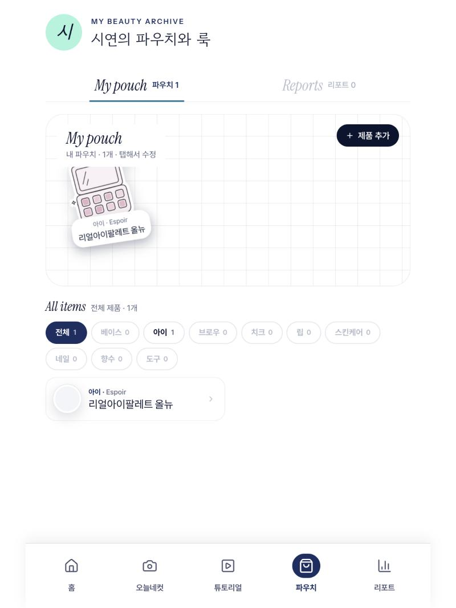
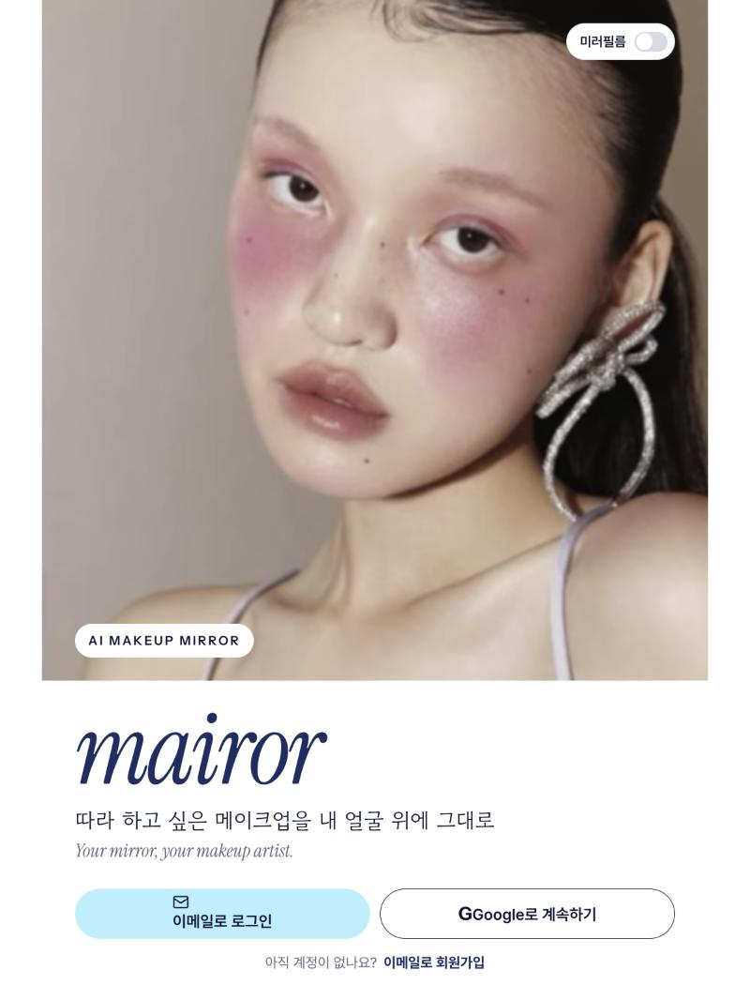
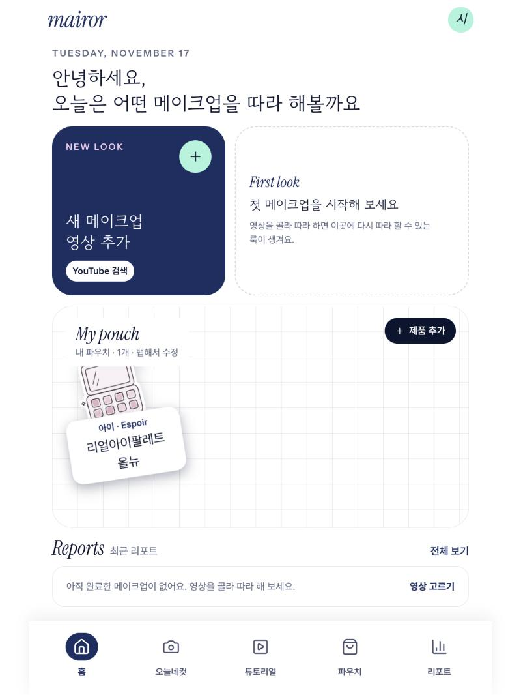
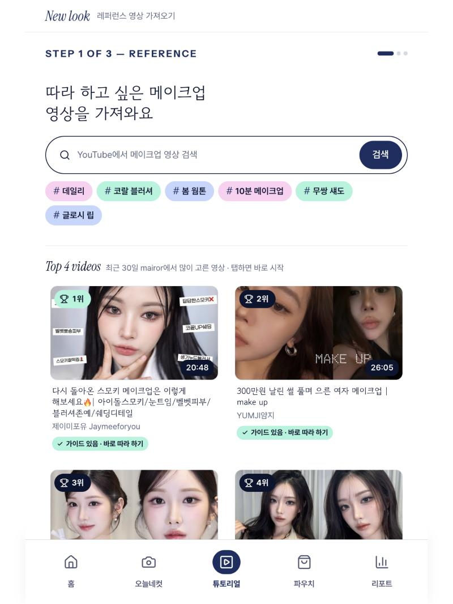
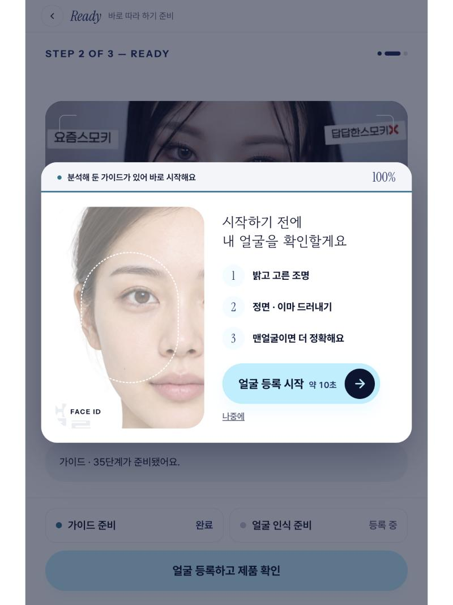

# 3. 시연 시나리오

| 항목 | 내용 |
| --- | --- |
| 주소 | https://mairor.co.kr |
| 기기 | 노트북 크롬 (웹캠) — 카메라 권한 "허용" |
| 계정 | `tester1@example.com` / `password1!` ([01 § 7.4](01-포팅매뉴얼.md#74-서비스-계정-시연--확인용)) |
| 영상 | 「다시 돌아온 스모키 메이크업은 이렇게 해보세요」 (`RBm4rzufBV0`, **20:48**). 이미 분석 · 검수가 끝난 가이드(총 35단계) 사용 |
| 따라 할 단계 | 상단 진행바를 눌러 **단계 목록**을 열고 **마지막 4단계**(`step_34` ~ `step_37`: 입술 2단계 → 눈썹 2단계)만 진행 후 마무리 |
| 예상 소요 시간 | 약 4분 |

> 버튼 이름은 실제 화면 글자 그대로 적었다.

---

## 0. 시연 전 준비

### 0.1 전날

- [ ] AI 서버를 시연 크기로 올려 둔다 (`m6i.2xlarge`, `AREA_LINES=6`) — [01 § 5.5](01-포팅매뉴얼.md#55-ai-서버-크기)
- [ ] 시연 시간 앞뒤로 `master` 머지를 멈춘다 (머지하면 운영 배포가 돈다)
- [ ] `tester1` 계정의 파우치에 시연용 제품이 들어 있는지 확인 (`Espoir 리얼아이팔레트 올뉴` 등)
- [ ] 같은 계정으로 다른 사람이 동시에 쓰지 않게 알린다 (공용 계정이라 파우치 저장이 409로 부딪힌다)



### 0.2 당일 아침

| 확인 | 방법 | 정상 |
| --- | --- | --- |
| 사이트 | https://mairor.co.kr | 첫 화면 |
| BE | https://mairor.co.kr/api/health | `{"status":"UP"}` |
| 서버 상태 | Grafana https://k15a306.p.ssafy.io → 알림 | Firing 없음 |
| 영상 전처리기 | 맥북 `python pipeline.py --serve` | 새 영상 분석을 보여 줄 때만 필요 |
| 카메라 | 시연 노트북 크롬에서 카메라 권한 허용 | 정상 송출 |
| 조명 | 얼굴 정면, 밝은 조명 | 얼굴 등록의 조명 · 거리 · 정면 검사 통과 |

---

## 1. 전체 흐름

```
① 로그인 ─▶ ② 홈 ─▶ ③ 영상 선택 ─▶ ④ 분석 결과 ─▶ ⑤ 얼굴 등록
   ─▶ ⑥ 제품 체크(내 파우치와 매칭) ─▶ ⑦ 마지막 4단계 따라 하기 ─▶ ⑧ 완성 · 리포트 ─▶ ⑨ 오늘네컷 · QR 공유
```

화면 위쪽 `STEP 1 OF 3` 표시가 ③ 영상 선택 → ④ 준비 · 얼굴 등록 → ⑥ 제품 체크 순서로 바뀐다.

---

## 2. 단계별 상세

### ① 로그인 — `/login`



> 캡처는 로컬 스택 화면이다(운영과 같은 코드).

1. 주소창에 `https://mairor.co.kr` → 로그인 화면으로 이동한다.
2. **이메일로 로그인**을 누른다.
3. **이메일**(`tester1@example.com`) · **비밀번호**(`password1!`)를 넣고 **로그인**을 누른다.

> 말할 것: 이메일 가입과 **Google 로그인**을 지원한다. 세션 쿠키는 HTTPS 전용(`__Host-`)이고 로그인 실패가 이어지면 잠긴다.

### ② 홈 — `/home`



- 내 파우치(`My pouch`) · 최근 리포트(`Reports`)가 보인다. 파우치에는 미리 **Espoir 리얼아이팔레트 올뉴** 등을 담아 둔다.
- 왼쪽 위 남색 카드 **새 메이크업 영상 추가**를 눌러 영상 선택으로 간다.

### ③ 영상 선택 — `/select` (`STEP 1 OF 3 — REFERENCE`)



1. 주제 칩과 아래에 **Top 4 videos**(최근 30일 mairor에서 많이 고른 영상)가 보인다.
2. 1위 「다시 돌아온 스모키 메이크업은 이렇게 해보세요」(`RBm4rzufBV0`, `가이드 있음 · 바로 따라 하기` 배지) 카드를 누른다.
   - Top 4에 없거나 다른 영상을 고를 때는 **YouTube에서 메이크업 영상 검색** 버튼을 눌러 열리는 검색 모달(`메이크업 영상 검색`)에서 키워드(예: `"스모키"`)를 검색해 고른다. (미분석 영상은 새로 분석이 시작된다.)

### ④ 분석 결과 — `/loading` (`STEP 2 OF 3 — READY`)



- 이미 분석된 가이드라 상단 바에 **분석해 둔 가이드가 있어 바로 시작해요 · 100%**가 표시되고, **얼굴 등록 안내 창**이 자동으로 뜬다.
- 안내 창의 **얼굴 등록 시작**(`약 10초`)을 눌러 ⑤ 얼굴 등록으로 진행한다.
  - 안내 창에서 **나중에**를 눌러 닫은 경우에는 하단 **얼굴 등록하고 제품 확인** 버튼을 눌러 다시 열 수 있다.
  - 새 영상이라면 `분석 중 N%`가 오르며 노트북 전처리기 → AI 서버 순서로 진행된다.

> 말할 것: 영상에서 화장품이 바뀌는 지점을 단계로 나누고(Gemini), 각 단계를 바를 얼굴 영역을 계산한다(AI 서버).

### ⑤ 얼굴 등록 — `/loading` 내 카메라 모달

1. 화면 안내에 맞춰 얼굴을 원 안 정면에 둔다.
2. **밝고 고른 조명 · 원 안 적정 거리 · 정면 · 가림 없음** 4가지 조건을 1.5초 유지하면 자동 촬영된다.
3. 체크 표시(등록 완료) 후 모달이 닫히면 하단의 **제품 확인하기** 버튼을 눌러 제품 체크(`/check`)로 넘어간다.

### ⑥ 제품 체크 — `/check` (`STEP 3 OF 3 — CHECK`)

1. 단계마다 **영상 제품**과 **내 파우치** 제품이 짝지어져 보인다(`보유` · `대체` · `없음`).
2. 대체 제품을 바꾸려면 해당 단계의 **바꾸기**를 누르고 파우치에서 제품을 고른다.
3. 하단의 **이 조합으로 시작**을 누른다. 확인 창이 뜨면 **건너뛰고 시작**(또는 **시작하기**)을 눌러 튜토리얼 안내로 넘어간다.

> 말할 것: 영상 속 제품과 내 파우치의 색을 비교해 가장 가까운 제품을 대체로 고른다. 없는 제품은 화장품 수집 요청으로 남는다.

### ⑦ 마지막 4단계 따라 하기 — `/tutorial/guide` → `/tutorial`

1. (이 기기 첫 진입 시) `/tutorial/guide`에서 사용 안내 3장을 **다음**(또는 **건너뛰기**)으로 넘긴 뒤 **단계 사진 저장에 동의해 주세요** 화면에서 **동의하고 시작**을 누른다.
2. `/tutorial`로 들어오면 상단 진행바를 눌러 **단계 목록**을 연다.
3. 목록에서 마지막 4단계의 시작 지점인 **`입술에 생기 더하기`(`step_34`, 32번)**를 눌러 이동한다.
   - 시연에서는 시간상 앞 단계들을 건너뛰고 **마지막 4단계**만 진행해 메이크업을 마무리한다:
     1. `step_34` **입술에 생기 더하기** (Nars 에어 매트 립 컬러 틴트 `#집시`)
     2. `step_35` **입술에 윤기 표현** (에스쁘아 꾸뛰르 립 틴트 듀이 글로이 `#코코크림`)
     3. `step_36` **눈썹 그리기** (에스쁘아 더브로우 배런스 펜슬 `#라이프토프`)
     4. `step_37` **눈썹 염색 및 정리** (에스쁘아 더브로우 컬러 픽싱 카라 `#토프`)
4. 각 단계에서 **시작하기**를 누르면 거울 화면 위에 이 단계의 **바를 영역**이 겹쳐 보이고, 하단 카드에 할 일이 나온다(**설명 펴기** · **설명 접기**).
5. 화장을 바른 뒤 **다음 스텝**을 눌러 촬영하면 발색 게이지가 **레퍼런스보다 연해요 / 비슷해요 / 진해요** 중 하나로 나온다.
   - 다시 찍으려면 **다시 찍기**, 제품 없이 넘기려면 **건너뛰기**를 누른다.
6. 마지막 단계(`step_37` 눈썹 염색 및 정리)에서 **완성하기**를 누른다(카운트다운 후 얼굴 전체 사진 촬영). 미리보기에서 **이 사진으로 완성**을 눌러 화장을 마무리한다.

> 말할 것: 얼굴 추적은 브라우저(MediaPipe)에서 돌아서 실시간 카메라 영상이 서버로 가지 않는다. 서버에는 동의를 받은 단계 사진만 저장된다.

### ⑧ 완성 · 리포트 — `/done` → `/my/report`

1. **기록을 저장했어요** 화면이 뜬다.
2. **리포트 보기**를 누르면 방금 진행한 단계별 사진과 발색·제품 결과가 정리된 리포트로 이동한다.

### ⑨ 오늘네컷 · QR 공유 — `/photo`

1. 아래 탭에서 **오늘네컷** 탭으로 간다.
2. **SSAFY 15기 기념 네컷 프레임**을 고르고 **촬영 시작** → 네 장을 연속 촬영한다(컷별 다시 찍기 가능).
3. **바로 완성 · 저장** → QR 코드가 생성된다. 휴대폰으로 스캔하면 로그인 없이 `/share/photo`에서 사진을 내려받을 수 있다(만료 후 삭제).

---

## 3. 장애 대비

| 상황 | 대처 |
| --- | --- |
| 카메라가 안 켜짐 | 주소창 자물쇠 → 카메라 허용 → 새로고침. 다른 앱이 카메라를 점유 중인지 확인 |
| 얼굴 등록 검사가 통과하지 않음 | 조명을 얼굴 앞쪽으로 비추고, 화면과의 거리 · 정면 각도 조정 |
| 로그인이 계속 풀림 | 다른 사람이 같은 계정으로 로그인했는지 확인 |
| 파우치 저장이 409 | 같은 계정을 다른 곳에서 수정 중. 새로고침 뒤 다시 시도 |
| 사이트 전체가 안 뜸 | EC2 콘솔 → 대상 그룹 `mairor-app-tg` 상태 확인, 필요하면 CI `rollback` |
| 새 영상 분석이 멈춤 | 맥북 전처리기 `--serve` 실행 여부 및 Grafana "노트북 응답 없음" 알림 확인 |

## 4. 예상 질문

1. **왜 실시간 카메라 얼굴 추적을 서버가 아니라 브라우저에서 처리하나요?**
   - 웹캠 영상 프레임을 매 프레임 서버로 보내면 지연(Latency)과 대역폭 부담이 커지고 민감한 얼굴 영상이 외부로 전송됩니다. MediaPipe Face Landmarker와 모델 파일을 정적 에셋(`frontend/public/`)으로 동봉해 브라우저에서 바로 추론하고, 사용자가 동의한 단계 촬영 사진만 서버에 업로드합니다.
2. **영상 전처리기를 AWS EC2가 아니라 팀 맥북에서 실행하는 이유는 무엇인가요?**
   - AWS EC2 공인 IP 대역에서는 YouTube가 봇 차단(`DOWNLOAD_REJECTED`)을 거는 경우가 많아 안정적으로 영상을 내려받을 수 없습니다. 그래서 BE가 작업 큐(lease 방식)를 열어 두고 로컬 전처리기(`video-processor --serve`)가 작업을 가져가 프레임·단계 추출 후 S3와 콜백 API로 결과를 전달하도록 분리했습니다.
3. **영상 속 제품이 내 파우치에 없을 때는 어떻게 매칭하나요?**
   - 화장품 카탈로그 DB에 등록된 제품의 호수별 대표 색상(Lab/RGB)과 사용자 파우치 제품의 색상을 비교해 같은 카테고리 내에서 색이 가장 가까운 순서로 대체 후보를 추천합니다. 카탈로그에 없는 신제품은 SQS 수집 큐(`ai/Dockerfile.collector`)에 적재해 브랜드 공식 사이트에서 비동기로 수집합니다.
