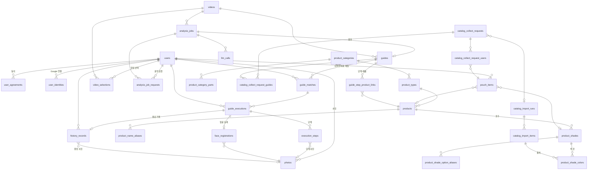

# 3. DB 덤프

| 파일 | 내용 |
| --- | --- |
| [`mairor-dump-20261117.sql`](mairor-dump-20261117.sql) | **운영 DB 최신본** (2026-11-17 16:52 KST 추출, 개인정보 가림). 일반 SQL, 스키마 + 데이터, 11 MB |
| [`dump.sh`](dump.sh) | 운영 DB에서 덤프를 다시 뜨는 스크립트 (BE 서버에서 실행) |

## DB 정보

| 항목 | 값 |
| --- | --- |
| 엔진 | PostgreSQL **17.11** (Amazon RDS `mairor-db`, `db.t4g.small`, 20 GB) |
| 접속 주소 | `mairor-db.cbu0kuyukft2.ap-northeast-2.rds.amazonaws.com:5432` — 프라이빗 서브넷이라 BE 서버에서만 닿는다 |
| DB 이름 | `mairor` |
| 계정 | `mairor` (비밀번호는 Parameter Store `/mairor/prod/DB_PASSWORD`) |
| 스키마 관리 | Flyway 없음. 운영은 `ddl-auto=validate`, 스키마 SQL을 손으로 적용 |
| 크기 | 복원 후 약 16 MB |

## 개인정보 가림

운영 덤프를 그대로 올리지 않고 아래를 바꾼 뒤 다시 덤프했다. 원래 이메일 · 이름 · 전화번호 · Google ID가 파일에 남지 않았음을 값마다 검색해 확인했다.

| 대상 | 처리 |
| --- | --- |
| 실제 회원 4명 (`users`) | 이메일 → `member1~4@example.com`, 닉네임 · 이름 → `회원N`, 전화번호 · 생년월일 · 성별 → 비움, 비밀번호 해시 → `tester1@example.com`과 같게 |
| 테스트 계정 6명 (`tester1~6@example.com`) | 그대로 (시연 계정) |
| Google 연결 (`user_identities.provider_subject`) | 원래 값의 해시로 바꿈 |
| 세션 ID (`photos` · `face_registrations` · `guide_executions` · `execution_steps`의 `session_id`) | 같은 규칙의 해시로 바꿈 (테이블 사이 연결 유지) |
| `spring_session` · `spring_session_attributes` | 비움 (세션은 지금 Redis에 있고, 이 두 테이블은 예전에 쓰던 것) |

사진 · 영상 프레임 **파일**은 DB가 아니라 S3 `mairor-prod-media`에 있다. 덤프에는 S3 경로(`storage_key`)만 있어서 다른 환경에서는 사진이 보이지 않는다.

## 복원

### 새 DB에 데이터까지 그대로

```bash
# 1) PostgreSQL 17 을 띄운다 (로컬은 저장소 루트에서)
docker compose up -d postgres

# 2) 덤프를 넣는다 (빈 DB 여야 한다)
docker compose exec -T postgres psql -v ON_ERROR_STOP=1 -U mairor -d mairor < exec/db/mairor-dump-20261117.sql

# 3) BE 를 띄운다 — prod 프로파일의 validate 검사를 통과한다
```

RDS 같은 원격 DB는 BE 서버에서 `postgres:17` 컨테이너의 `psql`로 넣는다.

```bash
docker run --rm -i -e PGPASSWORD="$DB_PASSWORD" postgres:17 \
  psql -v ON_ERROR_STOP=1 -h <호스트> -U mairor -d mairor < mairor-dump-20261117.sql
```

2026-11-17에 빈 PostgreSQL 17에 넣어 오류 없이 들어가고, 외래 키 제약이 모두 검증 상태임을 확인했다.

### 빈 DB로 시작 (덤프 없이)

`backend/src/main/resources/db/` 의 SQL을 이 순서로 적용한다. 참조 관계 때문에 순서가 중요하다.

```bash
cd backend/src/main/resources/db
for f in users products analysis pouch camera executions; do
  psql -v ON_ERROR_STOP=1 -d mairor -f schema/$f.sql
done
psql -v ON_ERROR_STOP=1 -d mairor -f seed/product-categories.sql   # 화장품 카테고리 · 종류
```

로컬 dev 프로파일은 `ddl-auto=update`라 빈 DB에서도 테이블을 만든다. 이미 있는 DB에 칸 · 테이블을 더하는 SQL은 `db/upgrade/<이슈번호>-*.sql`이고, 적용 기록은 [backend/README "DB 스키마"](../../backend/README.md#db-스키마)에 있다. (운영 덤프에는 모든 스키마 변경이 이미 반영되어 있다.)

## 덤프 다시 뜨기

BE 서버에서 root로(Session Manager → `sudo -i`) [`dump.sh`](dump.sh)를 실행하면 `/tmp/mairor-<날짜>.dump`(pg_dump custom 형식)가 생긴다. 읽기만 하므로 운영 데이터는 바뀌지 않는다.
제출본을 만들 때는 이 파일을 로컬 PostgreSQL에 복원해 [개인정보 가림](#개인정보-가림)을 똑같이 적용한 뒤 `pg_dump --no-owner --no-privileges`로 일반 SQL을 만든다. 원본 덤프는 서버 · S3 · 로컬에서 지운다.

## 테이블 구성

32개 테이블. 행 수는 이 덤프 기준.

| 영역 | 테이블 (행 수) | 스키마 파일 |
| --- | --- | --- |
| 회원 | `users`(10) · `user_agreements`(34) · `user_identities`(2) | `schema/users.sql` |
| 화장품 카탈로그 | `product_categories`(9) · `product_types`(38) · `product_category_parts`(0) · `products`(31) · `product_shades`(172) · `product_shade_colors`(357) · `product_shade_option_aliases`(0) · `product_name_aliases`(5) · `catalog_import_runs`(8) · `catalog_import_items`(8) | `schema/products.sql` |
| 영상 분석 | `videos`(7) · `video_selections`(8) · `analysis_jobs`(9) · `analysis_job_requests`(9) · `guides`(5) · `guide_step_product_links`(171) · `llm_calls`(0) | `schema/analysis.sql` |
| 파우치 · 수집 요청 | `pouch_items`(32) · `catalog_collect_requests`(49) · `catalog_collect_request_users`(6) · `catalog_collect_request_guides`(30) | `schema/pouch.sql` |
| 카메라 | `photos`(162) · `face_registrations`(45) | `schema/camera.sql` |
| 가이드 실행 · 기록 | `guide_matches`(66) · `guide_executions`(34) · `execution_steps`(1174) · `history_records`(2) | `schema/executions.sql` |
| (예전 세션) | `spring_session`(0) · `spring_session_attributes`(0) | – |

## ERD

외래 키 기준(덤프에서 뽑음). 칸 전체는 스키마 파일을 본다.



전체 외래 키 목록:

<details>
<summary>펼치기 (58개, 예전 세션 테이블 제외)</summary>

| 테이블 | 칸 | 참조 |
| --- | --- | --- |
| `analysis_job_requests` | `analysis_job_id` · `user_id` | `analysis_jobs` · `users` |
| `analysis_jobs` | `requested_by` · `video_id` | `users` · `videos` |
| `catalog_collect_request_guides` | `request_id` · `guide_id` | `catalog_collect_requests` · `guides` |
| `catalog_collect_request_users` | `request_id` · `pouch_item_id` · `user_id` | `catalog_collect_requests` · `pouch_items` · `users` |
| `catalog_collect_requests` | `import_run_id` · `target_product_id` · `target_shade_id` · `target_color_id` | `catalog_import_runs` · `products` · `product_shades` · `product_shade_colors` |
| `catalog_import_items` | `run_id` · `product_id` | `catalog_import_runs` · `products` |
| `execution_steps` | `execution_id` · `photo_id` | `guide_executions` · `photos` |
| `face_registrations` | `user_id` · `video_id` · `guide_id` · `photo_id` · `execution_id` | `users` · `videos` · `guides` · `photos` · `guide_executions` |
| `guide_executions` | `user_id` · `guide_id` · `match_id` · `face_registration_id` | `users` · `guides` · `guide_matches` · `face_registrations` |
| `guide_matches` | `user_id` · `guide_id` | `users` · `guides` |
| `guide_step_product_links` | `guide_id` · `product_id` · `shade_id` · `color_id` | `guides` · `products` · `product_shades` · `product_shade_colors` |
| `guides` | `analysis_job_id` · `video_id` · `reviewed_by` | `analysis_jobs` · `videos` · `users` |
| `history_records` | `execution_id` · `user_id` · `guide_id` · `video_id` · `completed_photo_id` | `guide_executions` · `users` · `guides` · `videos` · `photos` |
| `llm_calls` | `analysis_job_id` | `analysis_jobs` |
| `photos` | `user_id` | `users` |
| `pouch_items` | `user_id` · `product_id` · `shade_id` · `category_code` | `users` · `products` · `product_shades` · `product_types` |
| `product_category_parts` | `category_code` | `product_categories` |
| `product_name_aliases` | `product_id` | `products` |
| `product_shade_colors` | `shade_id` · `source_item_id` | `product_shades` · `catalog_import_items` |
| `product_shade_option_aliases` | `shade_id` | `product_shades` |
| `product_shades` | `product_id` | `products` |
| `product_types` | `category_code` | `product_categories` |
| `products` | `category_code` | `product_types` |
| `user_agreements` · `user_identities` · `video_selections` | `user_id` (+ `video_id`) | `users` (+ `videos`) |

</details>

## 주의

- 덤프는 **빈 DB**에 넣는다. 테이블이 있으면 `already exists`로 멈춘다(`ON_ERROR_STOP=1`).
- 덤프에는 소유자 · 권한 문장이 없다(`--no-owner --no-privileges`). 어느 계정으로 넣어도 그 계정 소유가 된다.
- 테스트 계정 비밀번호는 덤프에 해시로만 있다. 시연 계정 정보는 [01 § 7.4](../01-포팅매뉴얼.md#74-서비스-계정-시연--확인용).
